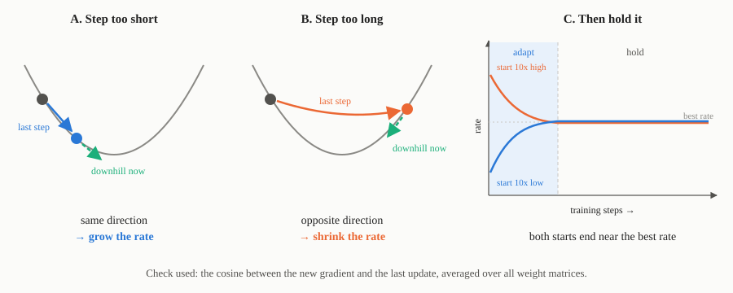
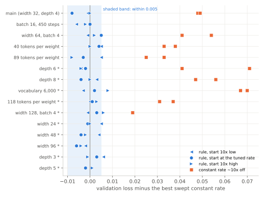
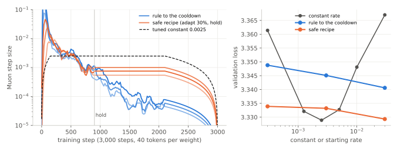
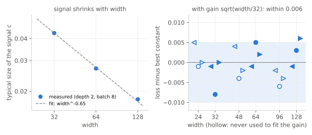
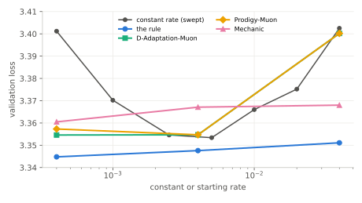
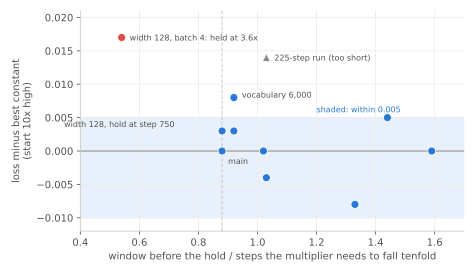

# Hypergradient Descent on the Muon Optimizer: Can One Language-Model Training Run Replace Trying Many Learning Rates in Separate Runs?

## Abstract

The Muon optimizer trains large language models, but its learning rate is still found by a sweep: copies of the model are trained at different rates, and the best is kept. We test whether an old rule, multiplicative hypergradient descent, can find Muon's rate in one training run. After each step, the rule compares the new gradient with the last step. If they agree, the step was too short and the rate grows; if they point apart, it shrinks. It was published for SGD and Adam; we apply it to Muon with three changes. We adapt only early and then hold the rate, because a rule left running keeps shrinking it, as we measure. The size of each adjustment grows with the square root of model width. Weight decay must be on. Started ten times too low or too high, it ends as good as the best rate from a sweep in 42 of 45 runs over 15 small-model settings. The rule beats three learning-rate-free methods on Muon. Comparing two consecutive Muon steps instead fails.

## In simple words

Training a model is like walking down into a valley in fog, and the learning rate is the length of each step. After a step, look at which way is downhill now. If it is still the way you just walked, your step was too short, so take longer steps. If downhill now points back, you walked past the bottom, so take shorter steps. This check is an old idea; we show that Muon can use it for the first part of training, then keep the step length it found.



*Figure 1. If downhill still points the way the last step went, the rate grows (A); if it points back, the rate shrinks (B); after the first part of training the rate is held (C).*

## 1. Introduction

A learning rate sets how far the weights move on each training step. Too small, and training crawls. Too large, and each step overshoots, so the loss stops falling. In our main setting the best constant rate, 0.005, reaches a validation loss of 3.3534. The same run at 0.0004 reaches 3.4012, and at 0.04 it reaches 3.4025. Validation loss is the error on text the model never trained on, so lower is better. A gap of 0.05 is large at this model size.

Muon (Jordan et al. 2024) is an optimizer for the weight matrices of a transformer. It turns each gradient into an update of fixed size, so its learning rate is exactly its step size. Muon now trains large models (Liu et al. 2025). Its rate is still found by a sweep. A sweep that covers a hundredfold range of rates needs 5-7 training runs.

Hypergradient descent (Baydin et al. 2018) tunes the rate during training. It nudges the rate up when the new gradient agrees with the last step and down when it disagrees. Its multiplicative form uses the cosine of the two, so the rule does not depend on their sizes. Funnel (Amid et al. 2022) writes the same rule as log s ← log s + γ · cos(gradient, last update), so that one gain γ works for layers of every size. Both were tested on SGD and Adam-type optimizers, for the whole run. Left running for the whole run, such rules shrink the rate too far, because they pick the best rate for the next step, not for the whole run (Wu et al. 2018; Donini et al. 2020). Learning-rate-free methods, such as D-Adaptation, Prodigy and Mechanic, take another path: they estimate how far the weights should travel.

We ask whether this old rule can replace the sweep for Muon, and what it needs to do so. Our answer is yes, with three changes: adapt only early and then hold, scale the gain with width, and keep weight decay on. We make four claims:

1. On Muon, started 10x too low or 10x too high, the rule ends within 0.005 of the best swept rate in 42 of 45 runs over 15 settings (section 4).
2. Adapting early and then holding fixes the drift toward too-small rates; we measure that drift directly (section 5).
3. The gain must grow as sqrt(width/32), which holds on three widths never used to fit it, and weight decay must be on for the signal to work (section 6).
4. On Muon the rule beats Mechanic, D-Adaptation and Prodigy, and the cosine of two consecutive Muon updates fails as a signal (section 7).

All models are small (0.04-1.3M weights) and train on one CPU thread. Claims about large models rest on trends along width, depth, run length and data.

## 2. The method

**Terms.** The gradient g is the direction in which the loss rises fastest, one number per weight. Training steps go the opposite way, downhill. Muon's update O is the gradient after momentum, reshaped so that every direction has the same size. The cosine of two directions is +1 if they point the same way, 0 if they are unrelated, and −1 if they point opposite ways. For example, the cosine of (1, 0) and (1, 1) is 0.71.

**The rule.** Muon already multiplies its update by a learning rate η. We add one more number s, shared by all weight matrices:

```text
c     = mean over matrices of cos(g now, O from the last step)
log s ← log s + k · c
k     = sqrt(width / 32)
stop changing s at step min(30% of training, 450); keep it fixed after that
```

The step each matrix takes is η · s · O. The schedule η still ends with a cooldown, a linear drop to zero over the last 30% of training. Weight decay shrinks every weight by a small fraction each step; it is on.

**Where it comes from.** The first two lines are multiplicative hypergradient descent (Baydin et al. 2018, Eq. 8) in the exponentiated form of Funnel (Amid et al. 2022, Eq. 12). Its sign is right for the usual reason: if W moves by −η s O, the chain rule gives dL/ds = −η ⟨g, O⟩, so a positive cosine means a bigger last step would have lowered the loss. We checked this for Muon numerically; both sides give 0.568103 (`theory_check.py`). What is new here is the setting and the recipe: Muon's orthogonalized update in place of an SGD or Adam step, one s for all matrices, the hold, the width-scaled gain, and the need for weight decay.

**Example.** Say the rate is ten times too small. After a step, downhill is still the way the step went. So the new gradient agrees with the last update, and c is about +0.02. Then s grows about 7 times in 100 steps. Now say the rate is ten times too large. The step jumps past the bottom of the valley, so downhill now points back. Then c is about −0.05, and s halves every 14 steps.

**Two versions.** The warmup-free version starts training at full speed and lets s do the warmup. A warmup is a slow start: the rate ramps up from zero over the first steps. A multiplier that starts low rises on its own, so it is already a warmup. We recommend this version. The warmup version keeps a fixed 5% ramp. It is better for large vocabularies, whose word table wants a slow start (section 8).

## 3. Setup

| Item | Value |
|---|---|
| Model | transformer with RMSNorm, RoPE, QK-norm, SwiGLU, no biases; main setting width 32, 4 layers |
| Data | FineWeb text, 1,000 most frequent tokens (6,000 and 24,000 in two settings), 64-token windows, each read once |
| Optimizers | Muon (momentum 0.95, 5 Newton-Schulz steps) on block matrices; Adam (rate 0.04) on the word table, output layer and norms |
| Main setting | batch 8, 900 steps, weight decay 1, 4.1 tokens per weight, 13-20 s on one CPU thread |
| Score | validation loss on 400 held-out windows |
| Baseline | the same run with a constant Muon rate, swept over 3-8 values per setting; weight decay and Adam rate also swept |

Tokens per weight is how much text the model reads per weight. Large models read 20-100 or more; our main setting reads 4.1, and long settings read 40-118. Each setting is run once. We call gaps under 0.005 ties. All 792 runs are in `results.jsonl`.

## 4. Claim 1: on Muon, the rule replaces the learning-rate sweep

**Claim.** One run of the rule ends as well as the best rate from a sweep. This holds from starts 10x too low, at the right rate, and 10x too high.

**Test.** We ran the rule in 15 settings. They vary width (8-128), depth (2-8), batch size (4-16), vocabulary (1,000-6,000) and data per weight (1.1-118 tokens per weight). Ten settings were never used to design the rule. In five of them, all starts come from one guess (0.005), so the high start is up to 20x the right rate.



*Figure 2. The rule (blue) ends within 0.005 of the best swept rate in 42 of 45 runs, from every start. A constant rate about 10x off (orange) loses 0.025-0.071. Settings marked * were never used to design the rule.*

**Result.** In 42 of 45 runs the rule is within 0.005 of the best constant rate. The worst run is 0.008 above it (vocabulary 6,000, start 10x high). A constant rate about 10x off loses 0.025-0.071. At width 96 the high start is 20x the right rate, and the rule still beats the best constant from all three starts (by 0.002-0.006). Appendix A lists every number.

**What it does not replace.** A linear decay to zero, with its own swept rate, beats the flat-then-cooldown schedule by 0.000-0.023. The rule finds the rate, not the shape of the schedule. One more setting, a vocabulary of 24,000, cannot be scored at 0.005. Its best constant rate is a 0.010 dip below its neighbouring rates, and the rule lands with the neighbours (+0.014 to +0.015).

## 5. Claim 2: adapt early, then hold

**Claim.** Left running, the rule drifts toward rates that are too small. Holding s after min(30% of training, 450) steps removes the drift.

**Why.** The rule settles where the cosine is 0, which is the rate that lowers the loss most on the next step. Late in training this next-step rate is smaller than the best rate for the whole run. This is the short-horizon bias of rate tuning (Wu et al. 2018; Donini et al. 2020). Early in training the two rates agree, so adapting early is safe.

**Test.** First, we measure the drift without acting on it. We train at the best constant rate with the gain set to 0 and log c. Second, we run 3,000 steps (40 tokens per weight) from three starts, with the rule left running and with the hold.



*Figure 3. A 3,000-step run from three starts. Left: all starts meet the tuned rate around steps 320-480; left running (blue), the rule keeps cutting the rate to 4-8e-5; adapting for 30% and then holding (orange) keeps it near the tuned rate. Right: loss against starting rate.*

**Result.** At the best constant rate, c averages −0.01 to −0.02 after step 250. The rule sums this bias: −0.01 per step over 2,000 steps cuts the rate by a factor of e^20. In the 3,000-step run the rule left running ends about fifty times too low and loses 0.012-0.020. Holding at 30% of training ties (+0.000 to +0.005), and so does holding at step 450 (+0.001 to +0.003). A fixed negative target for c instead of a hold works at one run length only: −0.01 is 0.004-0.007 behind, and −0.02 diverges from the high start.

**The hold must not come too early.** In a 900-step run the bias adds up over fewer steps, and the rule left running learns a 25-57x decay that happens to suit that length. Freezing s at step 100 loses 0.011-0.023, because s has not settled yet. The earlier of 30% of training and step 450 was a good hold point in every setting we tried. Section 8 gives the condition under which it is too early.

## 6. Claim 3: the gain grows with width, and weight decay is needed

**Claim.** The gain must grow as sqrt(width/32), and weight decay must be on. With one multiplier shared by all matrices, these two settings make the rule work across widths.

**Why.** The cosine is a ratio of sizes. The useful part of the gradient grows more slowly with width than its noise, so the cosine gets smaller in wider matrices. A larger gain makes up for it. Weight decay matters for a different reason. Without it, a rate that is too high makes the weights grow. Bigger weights turn the same step into a smaller change of direction, so the overshoot hides from the cosine.

**Test.** We log the typical size of c at widths 32, 64 and 128, and run the rule with gain 1 and gain sqrt(width/32). We then run three widths never used to fit the gain: 24, 48 and 96. For weight decay we run the rule with weight decay 0 and 2 from both 10x starts.



*Figure 4. Left: the signal shrinks about as width^−0.65. Right: with gain sqrt(width/32), the rule ends within 0.006 of the best constant at every width, including the three widths never used to fit the gain (hollow).*

**Result.** The typical size of c is 0.043 at width 32, 0.027 at width 64 and 0.018 at width 128. With gain 1 at width 128, the held rate spreads 3.1x across the three starts. With gain 2, which is sqrt(128/32), it spreads 1.7x. At widths 24, 48 and 96 all nine runs end within 0.005, and at width 96 the rule beats the best constant from all three starts.

Without weight decay, the cosine at a 10x-high rate was −0.012, no more negative than the −0.008 at the right rate. So the rule barely moved the rate, from 0.07 to 0.045. With weight decay 2 it closed 83-87% of the gap from both 10x starts.

One multiplier for all matrices also matters. With one multiplier per matrix, the rule loses 0.010-0.017. The multipliers on two MLP matrices run away to 250-420x, because the loss barely depends on their rate, so their cosine has nothing to pull them back.

## 7. Claim 4: comparisons on Muon, and a signal that fails

**Claim.** Placed in the same spot on Muon's rate, the rule beats D-Adaptation, Prodigy and Mechanic. Among other signals tried in its place, none works, and the cosine of two consecutive Muon updates fails outright.

**Test.** Each method replaces the multiplier s on Muon's rate, and everything else stays the same. We adapted D-Adaptation and Prodigy to Muon's geometry: their denominator uses the nuclear norm, the sum of a matrix's singular values. Mechanic wraps Muon with its own tuner. For the signals, we keep the rule and change only what c compares.



*Figure 5. Main setting. From a 10x-high start, D-Adaptation and Prodigy lose as much as a constant rate (0.047), because they can only raise the rate. Mechanic comes down but loses 0.007-0.015. The rule ties from all three starts.*

*Table 1. Mean gap to the best constant over three starts (0.1x, 1x and 10x), Mechanic against the rule.*

| Setting | steps | Mechanic | rule | rule better by |
|---|---|---|---|---|
| main | 900 | +0.012 | −0.003 | 0.015 |
| depth 3 / 5 / 6 | 900 | +0.020 / +0.015 / +0.012 | +0.003 / −0.001 / −0.003 | 0.017 / 0.016 / 0.015 |
| depth 8 | 700 | +0.032 | +0.000 | 0.032 |
| width 24 / 48 / 96 | 900 | +0.027 / +0.010 / +0.008 | +0.001 / −0.001 / −0.004 | 0.026 / 0.010 / 0.012 |
| vocabulary 6,000 | 900 | +0.015 | +0.002 | 0.012 |
| 118 tokens per weight | 4,000 | +0.003 | +0.002 | 0.002 |
| width 64, batch 4 | 3,000 | +0.006 | +0.002 | 0.004 |
| width 128, batch 4 | 3,000 | +0.004 | +0.002 | 0.002 |

**Result.** From 10x too high, D-Adaptation and Prodigy lose 0.036-0.066 in six more settings. The rule beats Mechanic by 0.010-0.032 in 9 of 12 settings and ties in the other 3. It never loses to Mechanic by more than 0.003 from any start. The 3 ties are the 3 runs of 3,000-4,000 steps. Mechanic needs about that long to settle.

**Other signals.** Two consecutive Muon updates have a cosine of 0.89-0.95 at any rate, because momentum carries most of one update into the next. With momentum 0.9, 0.95 and 0.99 we measured 0.8997, 0.9499 and 0.9899 even when the gradients are pure noise. A rule driven by that cosine sees "agree" at every rate, and its multiplier runs to 1000x. The gradient against the last gradient loses 0.021. The gradient against the total distance moved, close to Mechanic's signal, loses 0.025. A random sign in place of the cosine's sign loses up to 0.066. So the information is in the sign of the gradient-to-update cosine.

**Cost.** One run of the rule takes 1.05-1.10 times as long as one run at a constant rate. Per step, the rule adds 3mn multiply-adds for an m × n matrix. Muon's own Newton-Schulz steps cost about 15mn · min(m, n). So the rule adds under 1% to Muon at min(m, n) of 16 or more. A sweep costs 5-7 runs, so the rule reaches the sweep's loss at about a sixth of its compute. Its safe range of start rates, within 0.01 of the best loss, is 100x or wider in all 12 settings. A constant rate's safe range is 2-8x.

## 8. When it fails

**The rate needs time to fall before the hold.** From a high start, s must fall about tenfold before it is held. We measure the fall time, the number of steps s takes to fall tenfold, and divide the window before the hold by it. We use the warmup version here, where the window runs from the end of the warmup to the hold.



*Figure 6. Each dot is a run started 10x too high. When the window before the hold covers about one fall time (ratio 0.88 or more) and the run has 450+ steps, the rule ends within 0.008. The one run at ratio 0.54 is held at 3.6x the right rate and loses 0.017.*

At width 128 with batch 4 the cosine is small, so s falls slowly. The fall takes 559 steps, but the window is only 300. The rule holds 3.62x the right rate and loses 0.017. Holding at step 750 instead gives a window of 600 and a tie (+0.003). The warmup-free version fixes most of this: it gets its full gain from step 0 and a longer window. At width 64 with batch 4, starts 10x and 100x too high go from +0.034 and +0.029 to +0.002 and +0.006. At width 128 the 10x-high start goes from +0.017 to +0.006. Both optimizers must drop the ramp together; dropping only Muon's ramp loses 0.018-0.028 from every start at width 64.

**Very short runs.** At 225 steps, the next-step rate the rule finds is half the best rate for such a short run. The rule holds 0.006-0.007, while the best constant is 0.01-0.02. All three starts lose 0.007-0.014. From 450 steps on, the rule ties.

**Low starts are safer.** The multiplier rises about 3-4x faster than it falls. From 100x too low, the rule loses −0.001 to +0.012 in four settings. From 100x too high, it loses +0.004 to +0.028. So start at or below your guess.

**Large vocabularies want the ramp.** Without it, vocabulary 6,000 from 10x low loses 0.010. The warmup version ties there.

## 9. Who should use it

| Case | What to do |
|---|---|
| New model or data, no budget for a sweep, 450+ steps | Warmup-free rule; start at or below your guess |
| Large vocabulary | Warmup version of the rule |
| Under about 450 steps | Sweep a constant rate |
| A tuned rate and schedule already in hand | Keep them; the rule matches the rate, not the schedule |
| No weight decay on Muon matrices | Add weight decay first |
| Choosing a learning-rate-free method for Muon | The rule; it never loses to the others by more than 0.003 |

## 10. Limits

All models have 0.04-1.3M weights. The largest tests are width 128, depth 8, a 24,000-token vocabulary and 118 tokens per weight. The hold point min(30%, 450) was fitted on four settings. Runs of 10^4-10^5 steps are not tested, and there Mechanic, which tied at 3,000-4,000 steps, may pull ahead. The width law for the gain is a fit, confirmed on three unseen widths but not derived. Each setting was run once, so gaps under 0.005 are not ordered.

## 11. Related work

**The rule itself.** Growing a rate while successive gradients agree goes back to delta-bar-delta (Jacobs 1988) and Rprop (Riedmiller & Braun 1993), which do it per weight. Stochastic meta-descent (Schraudolph 1999) and hypergradient descent (Baydin et al. 2018) tune one rate from the product of the gradient and the last step. Baydin et al. also give a multiplicative form that uses the cosine of the two and is invariant to rescaling. Funnel (Amid et al. 2022) writes it as an exponentiated update, s ← s · exp(γ · cos(g, ν)), and notes that the cosine lets one γ serve layers of every size. Our update for s is this rule. We apply it to Muon's orthogonalized update, add the hold, the width-scaled gain and the shared multiplier, and show that weight decay is needed.

**Short-horizon bias.** Wu et al. (2018) show that greedy rate tuning picks rates that are too small for the whole run. MARTHE (Donini et al. 2020) tunes the rate schedule from hypergradients while looking further ahead. We measure the same bias on Muon and remove it by holding s, which needs no look-ahead.

**Other ways to skip the sweep.** Learning-rate-free methods (D-Adaptation, Prodigy, DoG, Mechanic) estimate a distance to the solution; section 7 tests three of them. GALA (Jiang et al. 2025) sets a rate for normalized SGD from gradient alignment and curvature. AdamX (Caldas et al. 2026) scales an Adam-style step by a cosine similarity. SASA (Lang et al. 2019) uses gradient statistics to decide when to cut SGD's rate. For Muon, AdaGO uses summed gradient norms, LANTON sets per-layer rates from gradient noise, Distance-Aware Muon (Demidovich et al. 2026) sets the step from the distance travelled from the start, and Moonlight (Liu et al. 2025) scales Muon's update to match Adam's so a tuned Adam rate can be reused. None of these tests hypergradient descent on Muon.

## References

Amid, Anil, Fifty, Warmuth 2022, Step-size adaptation using exponentiated gradient updates (arXiv 2202.00145). Baydin et al. 2018, Online learning rate adaptation with hypergradient descent (arXiv 1703.04782). Caldas, Belo, Soares 2026, AdamX: cosine similarity meets gradient descent (arXiv 2609.11867). Cutkosky, Defazio, Mehta 2023, Mechanic: a learning rate tuner (arXiv 2306.00144). Defazio & Mishchenko 2023, Learning-rate-free learning by D-Adaptation. Demidovich, Chakraborty, Malinovsky, Nedić, Richtárik 2026, Distance-Aware Muon (arXiv 2605.18999). Donini, Franceschi, Pontil, Majumder, Frasconi 2020, MARTHE: scheduling the learning rate via online hypergradients, IJCAI (arXiv 1910.08525). Hao et al. 2025, LANTON (arXiv 2510.14009). Ivgi et al. 2023, DoG. Jacobs 1988, delta-bar-delta. Jiang, Kavis, Mokhtari 2025, GALA (arXiv 2506.08419). Jordan et al. 2024, Muon. Lang, Xiao, Zhang 2019, SASA. Liu et al. 2025, Muon is scalable for LLM training (arXiv 2502.16982). Mishchenko & Defazio 2024, Prodigy. Riedmiller & Braun 1993, Rprop. Schraudolph 1999, stochastic meta-descent. Wu, Ren, Liao, Grosse 2018, Understanding short-horizon bias in stochastic meta-optimization. Zhang, Liu, Schaeffer 2025, AdaGO (arXiv 2509.02981).

## Appendix A: all 15 settings

*Validation loss minus the best swept constant (negative is better). * = never used to design the rule. Transfer settings (widths 24-96, depths 3 and 5) start from 0.0005 / 0.005 / 0.05.*

| Setting | steps | tokens per weight | best constant | constant ~10x off, low / high | rule from 0.1x / 1x / 10x | version |
|---|---|---|---|---|---|---|
| main, width 32, depth 4 | 900 | 4.1 | 3.3534 | +0.048 / +0.049 | −0.001 / −0.008 / +0.000 | warmup-free |
| batch 16 | 450 | 4.1 | 3.3455 | | −0.006 / −0.000 / −0.002 | warmup-free |
| width 64, batch 4 | 3,000 | 1.4 | 3.3101 | +0.041 / +0.054 | −0.001 / +0.005 / +0.002 | warmup-free |
| width 16, depth 2 | 3,000 | 40 | 3.3289 | +0.033 / +0.038 | +0.005 / +0.004 / +0.000 | warmup |
| width 8, depth 2 | 3,000 | 89 | 3.4353 | +0.033 / +0.025 | +0.005 / −0.003 / −0.008 | warmup |
| depth 6 * | 900 | 2.9 | 3.3489 | +0.071 / +0.041 | −0.004 / −0.002 / −0.004 | warmup |
| depth 8 * | 700 | 1.8 | 3.3672 | +0.056 / +0.047 | +0.003 / −0.004 / +0.000 | warmup |
| vocabulary 6,000 * | 900 | 1.1 | 5.1214 | +0.070 / +0.067 | −0.003 / +0.002 / +0.008 | warmup |
| width 8, 4,000 steps * | 4,000 | 118 | 3.4180 | +0.037 / +0.031 | +0.000 / +0.001 / +0.003 | warmup |
| width 128, batch 4 * | 3,000 | 1.2 | 3.2956 | 4x high: +0.019 | −0.001 / +0.003 / +0.006 | warmup; high start warmup-free |
| width 24 * | 900 | | 3.3644 | | +0.005 / −0.001 / +0.000 | warmup-free |
| width 48 * | 900 | | 3.3255 | | +0.004 / −0.004 / −0.002 | warmup-free |
| width 96 * | 900 | | 3.3015 | | −0.002 / −0.006 / −0.004 | warmup-free |
| depth 3 * | 900 | | 3.3533 | | +0.006 / +0.003 / −0.001 | warmup-free |
| depth 5 * | 900 | | 3.3471 | | −0.002 / −0.002 / +0.001 | warmup-free |

Main setting, starts 0.0004 / 0.004 / 0.04 (sections 5-7, Figure 5): constant 3.4012 / 3.3534 (best, at 0.005) / 3.4025; rule adapting to the cooldown 3.3448 / 3.3476 / 3.3511; random sign 3.4195 / 3.3612 / 3.3919; frozen at step 100 3.3658 / 3.3644 / 3.3766; one multiplier per matrix 3.3630 / 3.3672 / 3.3708; D-Adaptation 3.3546 / 3.3547 / 3.4002; Prodigy 3.3573 / 3.3547 / 3.4002; Mechanic 3.3605 / 3.3671 / 3.3680. Signals from 0.004: gradient vs last gradient 3.3744; gradient vs distance moved 3.3786.

Fall times (Figure 6), high starts, warmup version: window / fall time / ratio / held ÷ best rate / gap. Batch 32, 225 steps: 57 / 56 / 1.03 / 2.29 / +0.014. Batch 16: 113 / 79 / 1.44 / 1.19 / +0.005. Main: 225 / 254 / 0.88 / 1.21 / +0.000. Depth 6: 225 / 218 / 1.03 / 1.17 / −0.004. Depth 8: 175 / 171 / 1.02 / 0.63 / +0.000. Vocabulary 6,000: 225 / 245 / 0.92 / 1.15 / +0.008. 40 tokens per weight: 750 / 471 / 1.59 / 0.30 / +0.000. 89 tokens per weight: 300 / 225 / 1.33 / 0.88 / −0.008. 118 tokens per weight: 250 / 273 / 0.92 / 1.20 / +0.003. Width 128, batch 4: 300 / 559 / 0.54 / 3.62 / +0.017; held at step 750: 600 / 682 / 0.88 / 0.83 / +0.003.

## Appendix B: other findings

These are in the full record and are not claims of this paper.

- **Cooldown.** The rule replaces the rate sweep, not the cooldown. Without the cooldown it loses about 0.05 (3.4028 / 3.3955 / 3.3979).
- **Early peak.** The step size peaks at 6-22x the best rate around step 50, with no loss spike. Over the first 150 steps the training loss is below the constant run's from the right and high starts. Scaling the gain by the warmup ramp cuts the peak 2-7x.
- **Query and key.** Per-matrix cosines ask for 3.2-6.5x (query) and 2.0-4.8x (key) the mean rate. With QK-norm, a 16x query/key rate does not hurt. Without QK-norm it gains 0.023, as much as QK-norm itself.
- **Adam's rate.** The same rule with its own multiplier on Adam's word table and output layer works from starts up to 40x low. It cannot recover a 10x-high Adam rate (+0.029), because those cosines are about −0.003, ten times smaller than Muon's. One multiplier per optimizer beats one shared by both; the shared one loses 0.221 when Muon starts 10x high and Adam 10x low.
- **Correction after the hold.** A version that may only lower s after the hold ties only when its threshold is about 2 standard deviations of the cosine's noise (width 64 +0.003 / +0.001 from 1x / 100x high; main −0.009 / +0.005). At 1 standard deviation it drifts (+0.033). After the hold the cosine is flat (−0.004 to +0.001) over 0.7-3.8x the best rate, with a per-step spread of 0.026.
- **Schedules.** In the main setting the rule beats the swept cosine schedule (best 3.3503) from five of seven starts and ties the other two. The swept linear decay (best 3.3430) is 0.001-0.008 better than the rule.
- **Baseline speed.** Our Mechanic, D-Adaptation and Prodigy are unoptimized Python at 0.9-3.0 times a constant run's time, so their speed is not compared.

## Appendix C: reproduce

`drive.py` runs `ss.py` (every knob is a flag) and appends to `results.jsonl`. The headline is three runs of 13-17 s each on a laptop CPU:

```bash
cd conference-papers/llm-muon-self-step && nice -n 20 python3 drive.py "--width 32 --layers 4 --heads 4 --V 1000 --batch 8 --steps 900 --elr 0.04" share const:0.04 safe:0.04 safe:0.0004
```

Expected: the constant at 0.04 about 3.4025; the rule from 0.04 about 3.3537 and from 0.0004 about 3.3529; the best swept constant 3.3534. Figures 2, 4 and 6 are made by `figures/make_short.py`, Figures 3 and 5 by `figures/make_plots.py`; Figure 1 is drawn by hand (`figures/f0_idea.svg`).

The full record, with all 15 claims, 48 rounds and every run, is [PAPER-full.html](PAPER-full.html). The round-by-round notebook is `RESULTS.md`.
