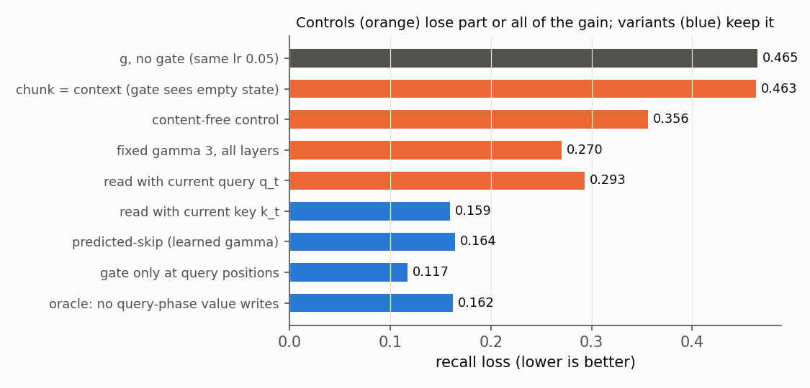
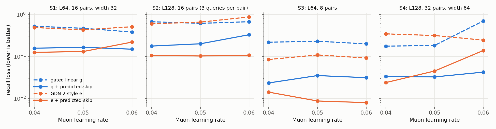
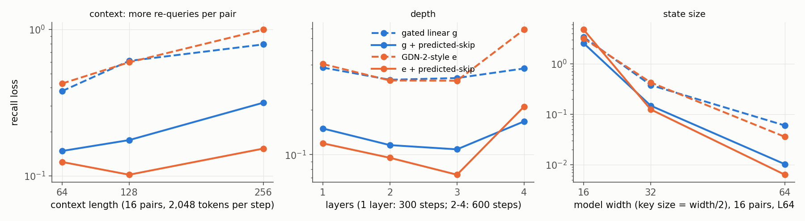
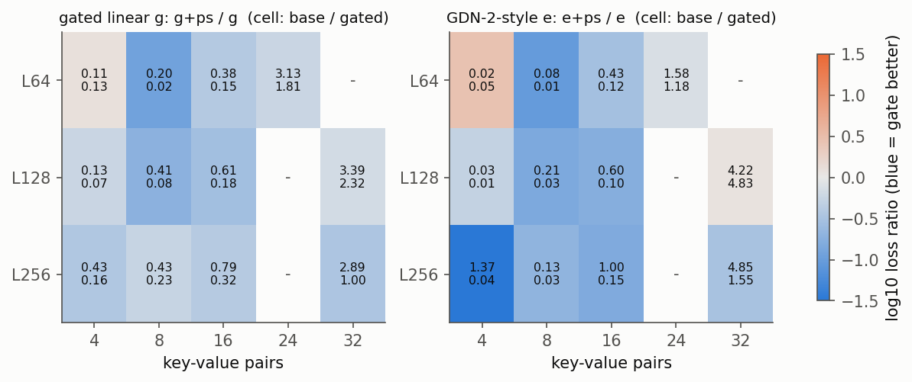

# Linear Attention Forgets Facts From Its Input Mostly Because It Writes Back Every Answer It Looks Up

> **AI conference paper setup by Vuk Rosić.** The idea is judged to be novel, and with further work it may be submitted to a top AI conference.

*Vuk Rosić · AI Research School · November 2026*

## Abstract

Linear attention stores every input token in one fixed-size memory. In associative recall, the input lists key-value pairs, then asks for the keys again. We show that most of the forgetting comes from one kind of write: the answer token, whose value the memory has just returned. An oracle that blocks only these writes lowers the answer loss of tuned gated linear attention from 0.45 to 0.14. Blocking the other writes after the pairs does nothing. Writing less when the memory already predicts the value is a known principle, used by the delta rule, Lattice and PH-attention. Our cheap form scales a write down when the memory's answer at the previous token matches the new value; chunked kernels already compute that answer. It adds one learned number per head. On small models it lowers answer loss two to ten times at every learning rate in four settings. It adds to Gated DeltaNet-2's learned erase step and to the delta rule. It ties on plain text at this scale and needs a model that already does the lookup.

## In simple words

Think of the layer's memory as a notebook with limited space. It reads the notebook to answer questions, and it writes every new line into the same notebook. When someone asks "what is A's number?", the layer looks it up and says "7". Then it writes "7" into the notebook again, which smudges the other entries. We find that these repeat writes cause most of the smudging. Our gate notices that the layer just read "7" a moment ago and barely writes it, so later questions get the right answers more often.


## 1. The problem and what is already known

Linear attention replaces the growing key-value cache of softmax attention with a fixed matrix S, the state. At each position t the layer reads S with the query, `y_t = S q_t`, and writes the new pair, `S <- a_t S + beta_t v_t k_t^T`. Here `k_t`, `q_t` and `v_t` are the token's key, query and value vectors, `a_t` is a decay between 0 and 1, and `beta_t` is the write strength. The delta rule first removes what S already stores at `k_t`. Gated DeltaNet-2 adds learned channel-wise erase and write gates computed from the token.

The state holds about as many clean pairs as its key size. Every extra write adds interference to the pairs already stored. Recent work traces this interference to how much a write overlaps what the memory already holds ("How Linear Attention Remembers", arXiv 2609.33093).

The idea of writing less when the memory already predicts the value is old. The delta rule writes only the error `v_t - S k_t`. Lattice (arXiv 2504.05646) writes only the part orthogonal to a slot's state. PH-attention (arXiv 2508.08289) scales the write by a running prediction error. Kaiser et al. (2017) skip a new memory entry when the memory already returns the right value. We do not claim this principle.

What we add is a measurement and a cheap gate. The measurement asks which writes cause the interference. In multi-query associative recall (MQAR), a sequence lists key-value pairs and then asks for keys again; the model must output the matching value. After the model outputs the answer, the answer token enters the sequence and is written into the state like any other token. The memory already holds it.

The gate scales the write strength by

```text
beta_t <- beta_t * exp( -gamma * relu( cos( S_c q_{t-1} , v_t ) ) )
```

`S_c q_{t-1}` is what the memory returned to the previous token's query, read from the state at the start of the current chunk (chunked kernels process 16-64 tokens at a time). `cos` is the cosine similarity with the value about to be written, and `relu` keeps only positive matches. `gamma = g0 * exp(w)` is one learned scalar `w` per head, starting at `g0 = 0.25`. When the previous read already returned `v_t`, the write is cut. When it returned something unrelated, the write is unchanged.

The read `S_c q_{t-1}` is the inter-chunk term a chunked kernel already computes for its output, shifted by one position. The gate therefore costs one cosine per token and head and one scalar per head.

## 2. Claims

| # | Claim | Evidence | Section |
|---|---|---|---|
| 1 | Writing back answers the memory just returned causes most of the recall interference: an oracle that blocks only answer writes lowers loss from 0.45 to 0.14, and blocking other writes does not help. | oracles on g and the delta rule; gate statistics; controls | 4 |
| 2 | A cheap redundancy gate, one scalar per head, that reuses the read the chunked kernel already computes, lowers answer loss two to ten times at every learning rate tried in four settings. | 4 settings x 3 learning rates; 900-step runs; read-source comparison | 5 |
| 3 | It composes with a GDN-2-style erase gate and with the delta rule. | e and e + ps in every cell; delta-rule cells | 6 |

Section 7 maps where the gate helps and where it does not. It is a usage guide, not a separate claim.

## 3. Setup

**Task.** MQAR over a synthetic vocabulary of 256 tokens. Keys come from the first half, values from the second half. A sequence of length L lists P key-value pairs, then fills the rest with queries: a key drawn again from the P pairs, followed by its value. Only the value after each query key is scored. Loss is cross-entropy on those answers, the answer loss (guessing gives about 4.85). Accuracy is the share of answers predicted exactly. Steps to 90% is the first evaluation step with accuracy at least 0.9, evaluated every 25 steps on 512 fixed sequences. With L = 64 and P = 16 each pair is queried about once; at L = 256 about seven times.

**Model.** A pre-norm model with RMSNorm, a SwiGLU MLP, untied embeddings and no biases. Each layer's mixer has q, k, v projections, a short causal depthwise convolution with SiLU, L2-normalized q and k, write strength `beta = sigmoid(w_b . h)`, a learned per-head decay and a per-head RMSNorm on the output. Default: 2 layers, width 32, 2 heads (key size 16), 300 steps, batch 32 at L = 64 (2,048 tokens per step), chunk 16.

**Arms.** Four linear-attention variants share one exact chunked recurrence, `S_t = a S - e (a S k) k^T + beta v k^T`, solved per chunk with a triangular solve:

- **g**, gated linear attention (Mamba-2-style scalar decay, `e = 0`).
- **D**, the delta rule without decay (`e = beta`, `a = 1`).
- **d**, the gated delta rule (Gated DeltaNet).
- **e**, a GDN-2-style competitor: the gated delta rule with a learned sigmoid erase gate, `e = beta * sigmoid(w_e . h)`. It is the strongest arm we could build at this size.

Each arm runs with and without the gate ("+ ps"). The gate changes nothing else.

**Training.** Muon on the block matrices; Adam on embeddings, norms and scalars, including the gate's `w`. Every main cell sweeps the Muon learning rate over 0.04, 0.05 and 0.06 for each arm separately, and we report each arm at its own best rate. Runs use fixed data and are not repeated. They are short and chaotic: at P = 16, single-run gaps under about 0.1 in loss are noise. We count a win only when it repeats across learning rates or cells. All runs are on a laptop CPU, 20-100 seconds each. 261 runs are logged in `results.jsonl`.

## 4. Claim 1: writing back answers the memory just returned causes most of the interference

**Why.** A write hurts recall when it adds a vector the memory does not need. The answer value adds nothing new, because the memory has just returned it. If answer writes are the main source of interference, blocking only them should recover most of the lost recall, and blocking other writes should not.

**Test.** On g in S1 (L64, 16 pairs), we block chosen writes by position, using the true phase of the sequence. Then we check that the learned gate finds the same writes on its own, and that controls which break the read-value link lose the gain.

**Result.** Table 1 shows the oracles.

| oracle (g, S1, learning rate 0.06) | loss |
|---|---|
| base, all writes | 0.447 |
| block all query-phase writes | 0.105 |
| block only answer writes | **0.138** |
| block only query-key writes | 0.503 |
| delta rule D, base / no answer writes | 0.694 / 0.173 |

*Table 1. Oracles. Blocking answer writes removes about 70% of the loss; blocking query-key writes does not help.*

Blocking answer writes gives almost all of the gain of blocking every query-phase write (0.138 against 0.105). Blocking query-key writes gives none. The delta rule already writes only the residual `v_t - S k_t`, yet blocking its answer writes still lowers loss from 0.69 to 0.17. In our setting, residual writing alone does not remove this interference.

The learned gate finds these writes without being told the phase. In layer 0 of the gated S1 run the mean gate is 0.93 at pair values, 0.79 at query keys and 0.14 at answer values. More than 98% of answer writes are cut below half strength; 6% of pair writes are. The gated model reaches the oracle's loss (0.164 against 0.162 at learning rate 0.05).

Controls that break the link between read and value lose the gain (Table 2, Figure 2). An empty read removes all of it: with one chunk as long as the sequence, the chunk-start state is empty, the gate is exactly 1, and the loss is the base level (0.463 against 0.465). Comparing with a value from another sequence removes about two thirds (0.356). Reading with the current token's query `q_t`, which does not perform the lookup, removes about 40% (0.293).

| probe (g, S1, learning rate 0.05) | what it changes | loss |
|---|---|---|
| base (no gate) | no gate | 0.465 |
| chunk = 64 = L | the read sees an empty state; gate is exactly 1 | 0.463 |
| content-free: `v_t` from another sequence | no content match | 0.356 |
| fixed gamma 0.25 / 1 / 3 | no learned per-head strength | 0.338 / 0.318 / 0.270 |
| read with `q_t` instead of `q_{t-1}` | the read is not the lookup | 0.293 |
| read with `k_t` | other read source (Section 5) | 0.159 |
| gate only in the query phase | variant | 0.117 |
| learned gamma (main) | none | **0.164** |
| oracle: no answer writes | perfect gate | 0.162 |

*Table 2. Probes. Single runs; gaps under 0.1 among the probes that keep the gain are noise.*



**Weaker.** The oracle and probes are single runs in one setting. The content-free control keeps about a third of the gain, so part of the effect is a general lowering of writes; the content match supplies the other two thirds.

## 5. Claim 2: a cheap gate that reuses the kernel's read

**Why.** The oracle is not a method, because the model does not know the phase. It can know whether its memory just returned the value. A chunked kernel already computes `S_c q_{t-1}` for the output at position t-1, so the check costs almost nothing.

**Test.** Four settings: S1 (L64, P16), S2 (L128, P16, batch 16), S3 (L64, P8) and S4 (L128, P32, width 64, so the load P / key size stays at 1). Each arm with and without the gate, three learning rates each, plus 900-step runs for speed.

**Result.** Table 3 lists each arm at its best learning rate.

| setting | g | g + ps | e (GDN-2-style) | e + ps |
|---|---|---|---|---|
| S1: L64, 16 pairs | 0.379 | **0.148** | 0.427 | **0.125** |
| S2: L128, 16 pairs | 0.610 | **0.176** | 0.597 | **0.102** |
| S3: L64, 8 pairs | 0.198 | **0.023** | 0.084 | **0.008** |
| S4: L128, 32 pairs, width 64 | 0.175 | **0.032** | 0.243 | **0.024** |

*Table 3. Validation loss on answers, lower is better, best of three learning rates per arm.*

In all four settings the worst learning rate with the gate beats the best learning rate without it (Figure 3). Accuracy for g rises from 0.91 to 0.96 in S1, from 0.87 to 0.95 in S2, and to 0.99 or higher in S3 and S4.



The gate also reaches a given accuracy in fewer steps (Table 4). The 90% target is too low for S3 and S4, whose bases pass it by step 150-225, so the table also shows 95%.

| setting | arm | steps to 90%: base / gated | steps to 95%: base / gated |
|---|---|---|---|
| S1 | g | 475 / 225 | never / 675 |
| S1 | e | 525 / 200 | never / 475 |
| S2 | g | 800 / 250 | never / 650 |
| S2 | e | 700 / 225 | never / 350 |
| S3 | g | 150 / 125 | 275 / 150 |
| S3 | e | 125 / 125 | 225 / 125 |
| S4 | g | 200 / 175 | 450 / 200 |
| S4 | e | 225 / 150 | 775 / 175 |

*Table 4. Steps to reach an accuracy, evaluated every 25 steps. S1, S2 and S4 use 900-step runs; S3 uses 300-step runs. "never" means not by step 900.*

At 95% the gate needs at least 1.8x fewer steps wherever both runs get there. In S1 and S2 only the gated runs get there. With three times the budget the bases still do not catch up: in S4 the 900-step loss is 0.069 against 0.010 for g.

**Which read to use.** Two reads can detect a just-returned value. The previous query's read `S_c q_{t-1}` is the lookup itself. The current key's read `S_c k_t` also works here: it gives 0.159 against 0.164 (Table 2), a gap well inside the noise. It works because the short convolution mixes the previous token, the query key, into `k_t`. We tried to separate the two reads by removing the convolution, but then no model retrieves at all (accuracy 0.07), so there is nothing to gate. We choose `q_{t-1}` for cost. Its read is the kernel's output term shifted by one position, in every variant. `S_c k_t` comes for free only in delta-rule kernels, which compute it for the erase term.

**Learned strength.** A fixed gamma loses 35-60% of the gain (0.270-0.338). The model learns gamma between 2.6 and 3.0 in both layer-0 heads and lowers it to 0.08-0.15 in layer 1. A fixed gamma of 3 also cuts writes in layer 1, where the model is not doing the lookup. Only the learned version switches that layer off.

**Weaker.** All four settings are one task family at one small scale.

## 6. Claim 3: it composes with GDN-2 and the delta rule

**Why.** A GDN-2-style erase gate and the delta rule both change how a write removes old content. Neither looks at whether the previous read returned the value. If the answer-write harm is separate from what they fix, the gate should add to them.

**Test.** The e arm with and without the gate in all four settings (Table 3). The delta rule D and the gated delta rule d with and without the gate in five further cells, at the same `g0 = 0.25`.

**Result.** e + ps is the best arm in every setting. It lowers e's loss from 0.427 to 0.125 in S1, 0.597 to 0.102 in S2, 0.084 to 0.008 in S3 and 0.243 to 0.024 in S4. Accuracy rises from 0.89 to 0.96 in S1 and from 0.86 to 0.97 in S2. In S4, e reaches 95% at step 775 without the gate and at step 175 with it.

The gated g also beats e without the gate in all four settings. So at this scale, the gate alone does more than the learned erase gate, and the two together do best.

The delta rule follows the same pattern. D at L64 P16: 0.754 to 0.150. D at L128 P16: 1.412 to 0.279 (accuracy 0.70 to 0.92). d at L64 P16: 0.716 to 0.226. d at P8: 0.098 to 0.016.

**Weaker.** In one delta-rule run (d at L64 P16, learning rate 0.05) the gated model failed (loss 0.97) and its layer-0 gamma stayed at 0.12; Section 7 shows that a small layer-0 gamma marks failures in general. An earlier gate with `g0 = 1` hurt the delta rule in one run, because it blocked writes before retrieval had formed; `g0 = 0.25` fixes this.

## 7. Where it helps and where it does not

The gate needs two things. First, a read that predicts the value: the base model must already retrieve. Second, a pair stored before the current chunk: the read uses the chunk-start state, so a pair and its query in the same first chunk give no signal.

**Scale knobs** (Figure 4).

- **Context.** For g the loss falls from 0.379 to 0.148 at L64, 0.610 to 0.176 at L128 and 0.790 to 0.316 at L256. For e it falls from 0.427 to 0.125, 0.597 to 0.102 and 0.997 to 0.154. The absolute gain grows with context for both arms, because each pair is queried more often.
- **Depth.** The gain holds from 1 to 4 layers (for example 0.326 to 0.109 for g at 3 layers). In every depth only layer 0 learns a large gamma (2.6-2.9); the others shrink it to 0.01-0.2.
- **State size.** At width 64 (key size 32): 0.060 to 0.010 (g) and 0.036 to 0.006 (e), a six-fold drop against three-fold at width 32.
- **Training length.** The gain holds at 600 steps. At 150 steps nothing has converged and the result is mixed.



**Map** (Figure 5).

- **Wins**: every cell at L128 and L256 with 4, 8 or 16 pairs, for both g and e (12 of 12). At 32 pairs and L256 the bases fail (accuracy 0.38 and 0.01) and the gated arms partly learn (0.72 and 0.63).
- **Ties**: L64 with 4 pairs, where the base is near its floor and the first queries see an empty read; with chunk 4 the same cell becomes a win for e (0.025 to 0.005). Chunk equal to sequence length always ties exactly. Natural text ties within 0.004 after 300 steps, and the model lowers gamma from 0.25 to 0.13. Text with 25-50% repeated rows ties within 0.013, because a width-32 model barely learns to copy.
- **Lottery or loss**: above capacity (24 or 32 pairs at key size 16) whether any arm learns retrieval is chance. At key size 8 the base never retrieves and the gate makes it worse (2.40 to 2.84).
- **Small batch**: at L256 with batch 8 the gated g needs learning rate 0.04.



Three rounds of written predictions for cells not yet run scored 3 of 5, 3 of 3 and 4 of 5. Each miss changed the rule above.

A single number marks the failures. Of the 23 gated runs that lose to their base by more than 10%, 17 have a layer-0 head whose learned gamma stays below 1.1. Of the 66 wins, 60 end with layer-0 gamma between 1.5 and 5.3.

## 8. Fairness and cost

Every arm in Table 3 has its own three-point learning-rate sweep and the same steps, batch, tokens, initialization and optimizer. The competitor e adds a learned erase gate with more parameters than ours (a learned vector per head against one scalar per head). The gate adds 2 parameters per layer at 2 heads. Median wall time over 73 paired runs is 1.16 times the base in our unfused code, which computes the read as a separate einsum. In a fused kernel the read is the output term shifted by one position, so the added work is one cosine, one exponential and one multiply per token and head.

At equal wall time the gate still wins: the gated g at 300 steps (0.148) beats the base at 600 steps (0.317) in S1.

We did not tune `g0` per cell. It was set to 0.25 once, after `g0 = 1` blocked learning above capacity, and held fixed for all later runs.

## 9. Who should use it

| your setting | use it? | what we measured |
|---|---|---|
| linear-attention or delta-rule layer, recall in the workload, base already retrieves | **yes** | 2-10x lower answer loss at every learning rate, four variants |
| long context with repeated lookups of the same facts | **yes** | gain grows from L64 to L256 |
| plain text at small scale | neutral | ties within 0.004; gamma shrinks on its own |
| chunk size equal to or longer than typical fact-to-query distance | no effect | gate is exactly 1 |
| state far over capacity, or tiny key size | no | lottery or loss |
| very small batch with a high learning rate | lower the learning rate | stable only at 0.04 at batch 8 |

## 10. Limits

- **Scale.** Width 16-64, 1-4 layers, at most 900 steps, context at most 256. No run used a production kernel or a model above one million parameters.
- **Task.** The gain is measured on synthetic recall. On text it ties. Whether it helps text recall at a scale where models copy is unknown.
- **Noise.** Single runs per cell; gaps under 0.1 at 16 pairs are noise. We report wins only where they repeat across learning rates or cells.
- **Read source.** We could not separate `q_{t-1}` from `k_t` in our model, because both carry the lookup once the short convolution is present.
- **Not tested.** Hybrid models mixing linear and softmax layers, and chunks of 64 with long contexts.

## 11. Related work

**Writing less when the memory already predicts the value.** This principle is old, and the gate is one more instance of it. Kaiser et al., "Learning to Remember Rare Events" (arXiv 1703.03129), skip a new memory entry when the memory already returns the correct value. The delta rule writes only the error `v - S k`. PH-attention ("Attention as Conditioning", arXiv 2508.08289), the closest work, scales `beta` by an associability state driven by a running average of the error `|v - S k|`, read through the current key. Lattice (arXiv 2504.05646) writes only the part of the update orthogonal to a slot's state. LoLA (arXiv 2505.23666) uses the self-recall error to choose which pairs go to a sparse exact cache, and HOLA (arXiv 2607.02303) uses the delta residual the same way.

**What differs.** These methods measure redundancy at the current key and build it into the update rule or a cache policy. We first locate the harm: re-written answers cause most of the interference, and the delta rule's residual write does not remove it (Section 4). Then we gate with the read the kernel already computed for the previous token, at one scalar per head. A current-key read works as well in our model (Section 5), so the difference is cost and kernel reuse, not what the gate can see.

**Why interference happens.** "How Linear Attention Remembers" (arXiv 2609.33093) finds in pretrained GLA and GDN models that later writes interfere with stored facts in proportion to their overlap with existing memory. An answer write overlaps maximally, since the memory has just returned it, which fits our diagnosis.

**Write and erase gates.** Gated DeltaNet-2 (arXiv 2605.22791) adds channel-wise write and erase gates computed from the current token; our competitor e follows it, and the two combine. Gated DeltaNet (arXiv 2412.06464) gates by a learned decay, DeltaProduct (arXiv 2502.10297) takes several delta steps per token, Longhorn (arXiv 2407.14207) derives its step size from an online recall objective, and Erase-then-Delta Attention (arXiv 2606.26560) erases along a learned direction before writing. Titans writes in proportion to the gradient of a memory loss. AURA (arXiv 2606.02775) gates a fast-weight memory by a surprise signal trained on robot action error.

## 12. ICML reviewer self-check

- *Is the principle new?* No. Prediction-gated writes are known (Section 11). The new parts are the diagnosis and a gate that reuses the kernel's read.
- *Is the baseline tuned?* Each arm has its own learning-rate sweep; the competitor is a stronger erase-gated delta rule.
- *Is the gain a learning-rate artifact?* The worst gated rate beats the best base rate in all four settings.
- *Is it the content or just fewer writes?* The content-free control loses about two thirds of the gain; the empty-read control loses all of it.
- *Does a current-key gate do the same?* Yes in our model (0.159 against 0.164, within noise). We use the previous query because its read is already computed in every variant.
- *Does it scale?* Monotone in context, depth and width over the ranges tested; untested at real scale.
- *Cost?* One scalar per head; one cosine per token and head in a fused kernel; 1.16x in unfused code.

## 13. Next steps

These are the remaining gaps to ICML, in the order to run them.

1. **Real scale first.** Train Gated DeltaNet and GDN-2 at 340M-1.3B parameters with a fused chunked kernel, with and without the gate. Test MQAR and RULER at 4k-16k context. Prediction: lower recall error with the gate, and no change in text perplexity.
2. **Compare with PH-attention directly.** Run its error-driven write scale in the same grid, alone and combined with the gate.
3. **Recall on real text.** Use a model large enough to copy, and test repeated names and document question answering.

## Appendix

**A. Reproduce.** `reproduce.sh` runs g and g + ps in S1 at learning rate 0.06 on a laptop CPU in about 40 seconds. Expected: about 0.38 and 0.15 loss, accuracy 0.91 and 0.96.

**B. Files.** `mix.py` (`chunked`): the exact chunked recurrence for g, D, d, e with the gate; `--lpsR` picks the read source. `rc.py`: task and training. `g.py`: driver. `figures/make_plots.py`: Figures 2-5. `figures/pairs.py`: pairs each gated run with its base and prints the layer-0 gamma. `RESULTS.md`: every round, with predictions written before results.

**C. Gate code (inside the chunk loop).**

```python
# St: state at the start of this chunk (b, H, dv, dk); q_prev: queries shifted by one
r = torch.einsum("bhvk,bhtk->bhtv", St, q_prev[..., s0:e0, :])      # what the memory returned to q_{t-1}
cs = F.cosine_similarity(r, v[..., s0:e0, :], dim=-1, eps=1e-6)
gamma = g0 * w_gate[layer].exp()                                     # one learned scalar per head
beta_c = beta[..., s0:e0] * torch.exp(-gamma[None, :, None] * F.relu(cs))
# ... then the usual chunked update with beta_c in place of beta
```

**D. Further oracles** (g, S1, learning rate 0.06): read before write 0.429. Depth details: 1 layer 0.383 to 0.150 (g) and 0.405 to 0.119 (e); 2 layers 0.317 to 0.116 and 0.314 to 0.095; 4 layers 0.378 to 0.167 and 0.688 to 0.210.
