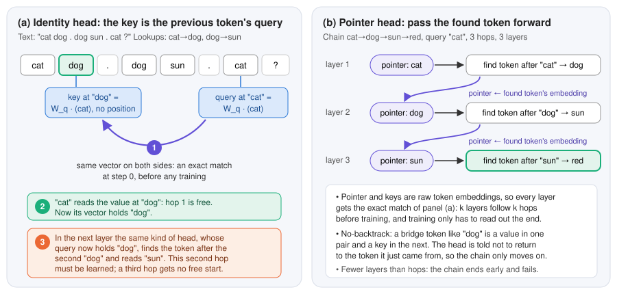
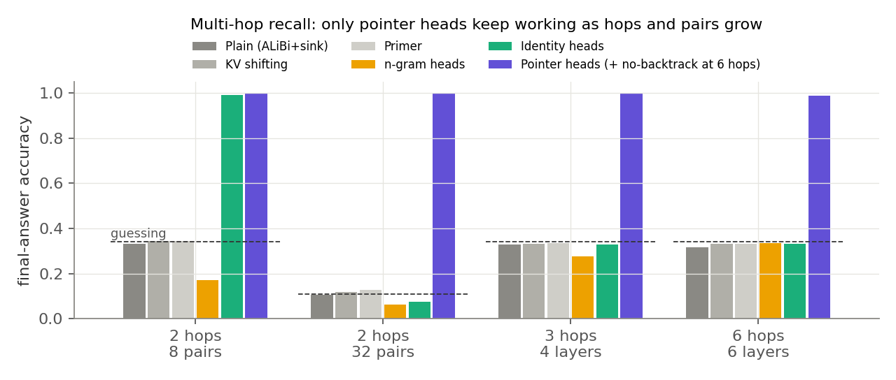
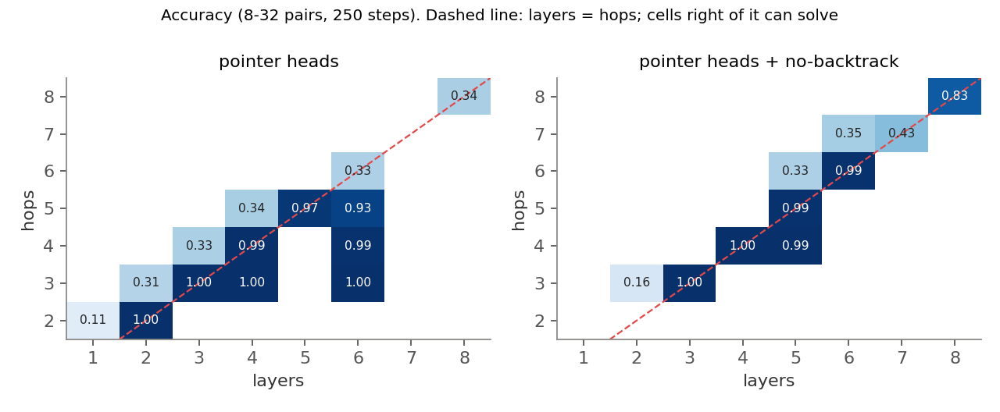
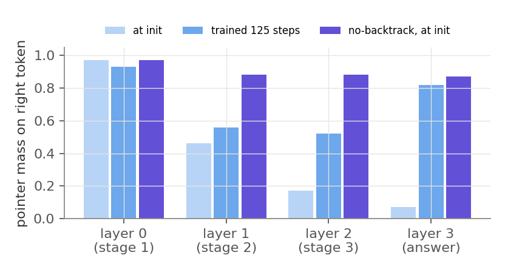
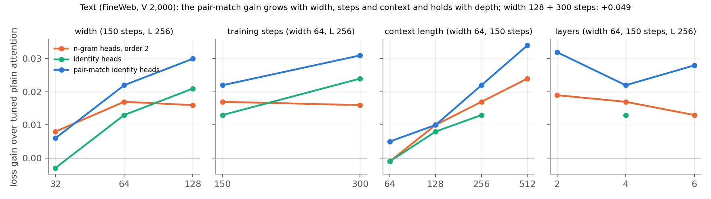

# Following Chains of Facts in the Prompt: One Modified Attention Head per Layer Follows One Link, Even When Training Checks Only the Final Answer

Vuk Rosić · [AI Research School](https://www.skool.com/become-ai-researcher-2669) · November 2026 · draft for ICML 2027

## Abstract

Give a transformer the facts cat→dog, dog→sun and sun→red in its prompt, ask about "cat", and score only the final answer, "red". In our runs (up to 1,200 steps, no middle answers, no curriculum), tuned attention stays at guessing: while the first lookup is wrong, later ones cannot lower the loss. We start from a head whose key is the previous token's query, as in Memory Mosaics, so a word finds what followed its earlier copy before training. Our addition is a pointer head: it hands the embedding of the word it found to the next layer's query, with a penalty for stepping back. Then k layers follow k links from the first training steps, for 2 to 6 links and 8 to 96 facts; fewer layers than links always fail. KV shifting, Primer and n-gram heads stay at guessing. Giving the key its own weights, adding position terms or freezing the pointer removes the gain: the exact match at initialization is the cause. The heads fail when a word repeats in wrong places and past 6 links.

**In simple words.** Imagine a phone book where each name points to another name, and you must follow three pointers to get the final number, but you are only ever told whether the final number was right. A normal model never learns this, because a wrong first step makes every later step look useless. Our change lets each layer find "the word that came right after this word last time" from the very first step of training, and hands the word it found to the next layer. So one layer follows one pointer, and training only has to learn to read off the end.

*Figure 1. (a) An identity head builds the key at each position from the previous token with the same query weights, so "cat" finds the slot after the earlier "cat" at step 0 and reads "dog". (b) A pointer head replaces its query with the embedding of the token it just found, so each layer follows one more link of the chain.*

## 1. Introduction

**The finding.** In our training budget, attention does not learn a chain of lookups when only the end of the chain is scored. Start from a head that matches tokens by identity, as in Memory Mosaics, make it pass the found token on to the next layer, and the chain works from the first steps of training. One layer is needed per link.

A *k-hop lookup* chains k lookups inside the context. The context lists pairs: block 1 maps cat→dog, block 2 maps dog→sun, block 3 maps sun→red. The question "cat?" has the 3-hop answer "red". Only "red" is scored; "dog" and "sun" are never shown as answers. Code has such chains, with the middle steps rarely labeled.

Tuned attention fails here, within the budget we test: 250-1,200 steps, widths 32-128, no middle answers and no curriculum. On our 2-hop task with 8 pairs, the model with ALiBi and an attention sink, KV shifting (Xu et al. 2024) and Primer's convolution (So et al. 2021) all settle at 0.34 accuracy. That is guessing among unused answers, at every learning rate from 0.01 to 0.08 and after 1,200 steps. When half of the training rows also ask one-hop questions, KV shifting solves it (0.97). So the model can represent the chain. It just never gets a training signal for the first hop when only the last hop is scored.

This is a claim about that budget only: other work shows trained transformers learning chains with curricula, more steps or other data (Mușat 2024; Wu, Geiger and Millière 2025; Sanford et al. 2024; Section 9).

The reason is credit assignment. At the start of training the first lookup returns a blur, so the second lookup cannot reduce the loss, and no gradient says "do the first lookup better".

The first hop can be given for free, and this part is not new. Memory Mosaics (Zhang et al. 2025, 2405.06394) build the key from the same function as the query, with no position encoding, and take the value from the next token; they note that one such layer is enough for induction. We add this unit inside a standard transformer and call it an identity head. Its key at j is the *query* of the token before j, so if that token equals the token at i the two vectors match exactly at step 0: "cat" attends right after the earlier "cat" and reads "dog".

One free hop is not enough for three, and this is our main addition. After layer 1, the query holds a mix of "cat" and "dog", and the next exact match is lost. A pointer head keeps the match exact in every layer. It carries a separate vector, the *pointer*, that starts as the token's embedding, is matched against previous-token embeddings, and becomes the embedding of the token it found. So layer l finds link l of the chain at step 0.

The finding rests on three claims:

1. **One layer per link.** Pointer heads with no-backtrack solve k-hop lookups if and only if the model has at least k layers. This holds for 2 to 6 hops, 8 to 96 pairs and widths 32 to 128. Every published competitor stays at guessing in every cell. Credit assignment explains both halves: each layer gets its link for free, and a missing layer cannot be learned (Section 4).
2. **Mechanism.** The gain comes from the exact match at step 0. Giving the key its own weights, adding a position term, switching the heads off at test time, or freezing the pointer each removes it (Section 5).
3. **Limits as a rule.** The heads fail on repeated words in wrong contexts, on queries that never repeat a stored token exactly, past 6 hops, and with fewer layers than hops (Section 7).

We also check that the identity unit keeps helping on web text when it sits inside a standard transformer, as Memory Mosaics found in their own architecture (Section 6). This is a check, not a new claim. Claims 1-3 held in every setting we ran.

## 2. Method

**Identity head.** A normal head scores position j for query position i as q_i · k_j, with q = W_q h and k = W_k h, and usually a position term. An identity head instead uses

  score(i, j) = t · q̂_i · q̂_{j−1},

where q̂ is the query after its usual normalization (QK-norm), and t is a learned temperature per layer, started at 3 × √d_k. There is no RoPE or ALiBi on this head, the value is normal and the key weights are unused. This is the Memory Mosaics form (2405.06394): key Norm(W_φ x), the same function as the query, with a learned bandwidth β and the value from the next token. Only the setting differs: such heads sit next to normal heads in a standard transformer. We use 2 identity heads per layer on recall tasks and 1 on text.

At step 0 the hidden states are close to the embeddings, so a repeated token gives q̂_i = q̂_{j−1}, the largest possible score t.

**Pair-match variant.** On text, a single token is a weak key. "the" appears everywhere. The pair-match variant adds a second term that rewards a match of the token before as well:

  score(i, j) = t · q̂_i · q̂_{j−1} + g · q̂_{i−1} · q̂_{j−2},

with a learned g per layer started at 0.001. This is close to the averaged keys of Memory Mosaics, which also mix in earlier tokens. Starting g small matters. With g = 1 at the start, text loss is the same, but 2-hop recall breaks (0.125), because the token before a query has nothing to do with its answer.

**Pointer head (new).** Keep a pointer vector P next to the hidden state. P_0 is the token embedding. In layer l, the first identity head computes

  a(i, j) = softmax_j( t · W_q P̂_l(i) · W_q ê(j−1) ),  P_{l+1}(i) = Σ_j a(i, j) e(j),

where e(j) is the embedding of the token at j. So P becomes the embedding of the token found. A learned gate per layer (sigmoid, started at 0.88) mixes this pointer query and key with the normal identity query and key, so the model can fall back on text.

**No-backtrack.** A bridge token like "dog" plays two roles. In block 1 it is a value (cat→dog). In block 2 it is a key (dog→sun). With the pointer at "dog", the head can find "sun" or return to the "dog" it came from, so at init the signal halves with each hop (0.97, 0.46, 0.17, 0.07 over 4 layers). The no-backtrack term subtracts 3 · cos(P_{l−1}(i), e(j−2)) from the pointer score. It lowers positions whose token two back is the one the pointer just left. With it, the mass on the right token stays at 0.87-0.88 in every layer at init (Figure 4).

**Cost.** All variants keep the parameter count of the base model; identity heads reuse W_q. Section 8 gives the compute.

## 3. Setup

**Recall task.** The context has k blocks of N (key, value) pairs. Block c maps tokens from vocabulary range c to range c+1, in its own random order. Then come N queries, one per range-0 key. Only the final answer after all k hops is scored. Guessing among unused answers gives about 0.34 at 8 pairs and 0.11 at 32 pairs. Variants add filler tokens between pairs, repeat stored tokens in wrong places, replace some queries with a fixed synonym token, or use two-token keys.

**Text.** FineWeb, a 2,000-token vocabulary, validation loss on held-out text. The base text cell is width 64, 4 layers, 4 heads, context 256, batch 16, 150 steps.

**Model.** A small transformer with QK-norm, an attention sink, ALiBi on normal heads, and Muon on the weight matrices (Adam on embeddings and scalars). Recall models have 1 to 8 layers, widths 32 to 128 and 2 to 8 heads, and train 250-300 steps with early stopping at 0.99.

**Arms.** Every recall cell runs the same arms on the same base:

| Arm | What it adds | Source |
|---|---|---|
| Plain | ALiBi + attention sink (the tuned base) | |
| KV shifting | keys and values mixed with the previous position's | Xu et al. 2024, 2411.19574 |
| Primer | depthwise convolution over keys, queries and values | So et al. 2021, 2109.08668 |
| n-gram heads | heads that attend to positions after exact token matches, order 1 or 2 | Akyürek et al. 2024, 2401.12973 |
| Identity heads | Section 2 | Memory Mosaics form (2405.06394), placed inside a standard transformer |
| Pointer heads | Section 2, with no-backtrack | this paper |

**Tuning.** Each arm got its own learning-rate sweep. On recall, plain attention, KV shifting and Primer were run at 0.01-0.08 and at 1,200 steps; none leaves guessing. Identity and pointer heads work at 0.02 and 0.04. On text at width 128, plain attention, n-gram heads and pair-match heads were swept at 0.02-0.08; all are best at 0.04.

**The grid.** The study ran 243 runs, one factor at a time and in pairs: hops, pairs, layers, width, heads, head size, temperature, filler, repeats, synonyms, two-token keys, and on text width, steps, context and depth. Before each block we wrote the current rule and 3-5 predictions.

## 4. Claim 1: pointer heads solve k hops with k layers

**Why.** In a pointer head, the query and the keys of every layer are raw embeddings, not hidden states. So the exact match of Section 2 holds in every layer, not only the first. At step 0 layer l finds link l, and training only has to read out the last link. With fewer layers than links, the chain stops early, and no amount of training adds the missing step.

**Test.** Four headline cells against all arms, then hops against layers.

*Figure 2. Final-answer accuracy in four recall settings. Dashed lines: guessing. Pointer heads solve all four; identity heads solve only 2 hops with 8 pairs; every published arm stays at guessing.*

**Result.** Pointer heads reach 0.99-1.00 in all four cells (Figure 2). Every published arm stays at guessing (0.31-0.34 with 8 pairs, 0.06-0.13 with 32). N-gram heads match token ids in every layer, so after the first hop returns "dog" the next layer still looks for "cat".

Identity heads alone solve 2 hops with 8 pairs at step 75. They fail with 32 pairs (0.075) and at 3 and 6 hops (0.33).

*Figure 3. Accuracy of pointer heads for hops (rows) against layers (columns). Dashed line: layers = hops. Left: plain pointer heads. Right: with no-backtrack. Every cell left of the line fails; with no-backtrack every cell on or right of it solves, up to 6 hops.*

The depth rule held in every cell of Figure 3. With fewer layers than hops, accuracy stays at guessing in all 7 cells tried, including 2 hops with 1 layer (0.11) and 7 hops with 6 layers (0.35). With at least as many layers as hops, pointer heads with no-backtrack solve 2 to 6 hops at step 25. Without no-backtrack, the chain already fails at 6 hops (0.33) and becomes fragile at 5 hops (0.93-0.97).

The rule also holds as pairs grow. With no-backtrack, 4 hops with 32 pairs solve at step 25 (1.000; without it 0.123), and 5 hops with 16 pairs solve too (1.000). Width 32, where each head has only 8 dimensions, solves 4 hops (0.990; without no-backtrack 0.321). Heads (2-8), RoPE on other heads and temperatures 1-10 do not matter at width 64.

**Three hops at long contexts.** One 3-hop cell failed: width 32 (8 dimensions per head) with 48 pairs, 384 tokens (0.033). The exact-match score, 3 × √8 = 8.5, does not stand out among 384 positions. We predicted that a sharper temperature (10) would fix it and that wider heads would not need it. Both held:

| 3 hops, 3 layers, pointer heads + no-backtrack | width 32 | width 64 | width 128 |
|---|---|---|---|
| 48 pairs (384 tokens) | 0.033 (temp. 3) / 0.991 (temp. 10) | 1.000 | |
| 64 pairs (512 tokens) | | 1.000 | |
| 96 pairs (768 tokens) | 0.998 (temp. 10) | 0.997 | 1.000 |

Tuned attention with 64 pairs ends at 0.010 (guessing 0.016). Three hops hold up to 96 pairs while the exact-match score stays well above the log of the context length.

**Where it is weaker.** At 7 and 8 hops with enough layers, the chain forms at step 25 (above 0.90) and then training pulls it apart (0.43 and 0.84 at the end). We have not found why. Identity heads without the pointer stay at guessing at 3 hops, even after 600 steps (0.336).

## 5. Claim 2: the exact match at step 0 is the cause

**Why.** If the gain comes from the exact match at init, anything that breaks the match should remove it; if the head only adds capacity, it should not.

**Test.** Five controls on identity heads (2 hops, 8 pairs, 3 layers, trained to 0.99) and two on pointer heads (4 hops, 5 layers).

| Control | Accuracy | What it shows |
|---|---|---|
| Identity heads, trained | 0.993 | |
| Key from the head's own W_k, no position | 0.171 | the shared projection is needed |
| Tied, with RoPE on the identity heads | 0.199 | the match must not depend on distance |
| Tied, with ALiBi on the identity heads | 0.333 | same |
| All identity heads switched off at test time | 0.025 | the trained model uses them |
| Only layer 1's identity heads switched off | 0.019 | layer 1 does the first hop |
| As many normal heads switched off | 0.868 | the drop is specific to identity heads |
| Pointer heads, trained (4 hops, 5 layers) | 0.993 | |
| Pointer frozen at the embeddings at test time | 0.021 | the pointer update carries the chain |
| Only the read-out layer's identity heads off | 0.015 | |
| Any other single layer's identity heads off | 0.993-0.995 | |

**Result.** Each control that breaks the exact match drops accuracy to guessing or below. Switching off normal heads costs only 0.13. Freezing the pointer drops accuracy to 0.021, and only the last layer's head output matters: earlier layers act through the pointer they update.

*Figure 4. Attention mass of the pointer head on the correct link of the chain, by layer (4 hops, 4 layers). At init without no-backtrack it halves per layer; training restores it only partly. No-backtrack keeps it near 0.9 in every layer from step 0.*

A probe of the trained 5-layer model shows layer l's pointer head on chain stage l (mass 0.72-0.95), with layer 4 on the answer and layer 5 idle: the depth rule seen from inside. Figure 4 shows why no-backtrack matters.

Pointer heads do not care about tying, RoPE or temperature (all 0.996-0.999).

These controls cover the multi-hop case. They do not show that one-hop copying needs an exact match at init: induction heads form even with frozen random query and key weights (2506.01115). Our claim is narrower: with only the final answer scored, within our budget, breaking the match leaves the chain at guessing.

## 6. Text check: the identity unit inside a standard transformer

Memory Mosaics already train this unit on text, up to about 10B parameters (2507.03285). This section only checks that it still helps when it sits next to normal heads in a standard transformer, and compares it with n-gram heads at the same budget.

**Why.** On text, many next tokens copy what followed an earlier occurrence of the current context. An identity head finds earlier occurrences without having to learn the match first. The pair-match term makes the match specific: "of the" instead of any "the". A longer context holds more earlier occurrences, so the gain should grow with it, and with width and steps.

**Test.** Pair-match identity heads without ALiBi (1 per layer) against plain attention, order-2 n-gram heads, identity heads, Primer, KV shifting and pointer heads. Move width, steps and context one at a time from the base cell, then width with steps and width with context.

*Figure 5. Loss gain over tuned plain attention on web text (positive is better), along width, training steps, context length and depth. Blue: pair-match identity heads. Green: identity heads. Orange: order-2 n-gram heads.*

**Result.** The pair-match gain grows along every knob (Figure 5):

- width 32, 64, 128 at 150 steps: +0.006, +0.022, +0.030;
- 150 and 300 steps at width 64: +0.022, +0.031;
- context 64, 128, 256, 512: +0.005, +0.010, +0.022, +0.034;
- width 128 with 300 steps: +0.049; width 128 with context 512: +0.048;
- depth 2, 4, 6 layers at width 64: +0.032, +0.022, +0.028, where the n-gram gain shrinks (+0.019, +0.017, +0.013).

The n-gram gain flattens at about +0.016-0.025. At width 128 the pair-match variant beats n-gram heads by 0.014 (150 steps, both at their best rate), 0.028 (300 steps) and 0.023 (context 512). Primer (−0.002) and KV shifting (+0.002) give nothing on text at width 128. All three predictions written before these runs held.

**Where it is weaker.** Below width 64 at 150 steps, and at context 64, the gain is under 0.01 and n-gram heads tie it. Width 32 recovers at 300 steps (+0.021). Pointer heads keep about half the text gain (+0.011 against +0.021 for identity heads at width 128). They are for retrieval-heavy models; for text alone, the pair-match variant is better.

## 7. Claim 3: where the heads fail

**Why.** The heads assume that the queried token appears earlier exactly once, in the right place. Any input that breaks this assumption should hurt.

**Test.** Four kinds of noise on 2-hop recall, and the depth limit from Section 4.

**Result.**

| Condition | Identity heads | Pointer heads | Why |
|---|---|---|---|
| Same word repeated in a wrong place, in 25% / 50% / 100% of rows | 0.956 / 0.866 / 0.282 | 0.950 / 0.899 / 0.786 | the match finds two candidates and splits |
| Query written as a fixed synonym in 25% / 50% / 75% / 100% of rows | 0.944 / 0.957 / 0.914 / 0.340 | 0.937 at 50%, 0.709 at 75%, 0.754 at 100% | with no exact repeat, nothing matches at init |
| Two-token keys, 1 layer | 0.167 (pair-match, order-2 n-gram heads and Primer solve) | | one token is not enough to find the key |
| Fewer layers than hops | fails | fails | one layer per link |
| 7-8 hops with enough layers | fails | forms at step 25, then lost (0.43-0.84) | unknown |

Synonyms are learned while at least a quarter of rows keep exact repeats, which train the second hop.

**The rule.** Use pointer heads, with no-backtrack and at least one layer per hop, when a model must follow chains of lookups through its context and only the end is scored. Use pair-match identity heads for text: their gain grows with width, steps and context. Do not expect either to help when the queried token repeats in wrong places or never repeats exactly.

| Case | Recommendation | Evidence |
|---|---|---|
| Multi-hop lookups, k hops, only the answer scored | pointer heads + no-backtrack, at least k layers | Claim 1 |
| 2 hops only, few pairs | identity heads are enough | Claim 1 |
| Language modeling, width ≥ 64, context ≥ 256 | pair-match identity heads, no ALiBi on them | Section 6 |
| Small width with short training, or short context | no gain; skip | Section 6 |
| Keys that repeat in wrong places or never repeat exactly | no fix from these heads | Claim 3 |

## 8. Cost

All variants have the same number of parameters as the base model (194,560 weights in the text model). Identity heads reuse W_q; their key weights could be removed. The pair-match term adds one more query-key product for one head per layer. The pointer adds one query projection of the pointer and of the embeddings, plus one weighted sum of embeddings, for one head per layer. So the extra compute is at most one head's attention per layer, under 1/H of attention for H heads. We did not measure a wall-clock difference; laptop times were dominated by other jobs.

## 9. Related work

**Memory Mosaics** (Zhang, Nolte, Sadhukhan, Chen and Bottou, ICLR 2025, 2405.06394) are the source of the identity head. Their key uses the same function as the query, k_T = Norm(W_φ x_T), with a learned bandwidth β and no position encoding, and the value comes from the next token; one layer is enough for induction. Their averaged keys are close to our pair-match term, and "Memory Mosaics at scale" (2507.03285) trains the architecture at about 10B parameters. We claim none of this. What we add is the pointer head, which chains raw embeddings across layers, the no-backtrack term, the one-layer-per-link rule with its credit-assignment cause, and the controls in Section 5.

**N-gram heads** (Akyürek et al. 2024, 2401.12973) hard-code heads that attend to the positions after exact token matches. They are the strongest published competitor on text, but they match token ids in every layer, so they fail every multi-hop cell.

**KV shifting** (Xu et al. 2024, 2411.19574) and **Primer** (So et al. 2021, 2109.08668) mix each key with the previous position's. They make induction heads easier to learn, but their keys stay untied and position-dependent, so there is no exact match at init. Both stay at guessing on every multi-hop cell. **Multi-Token Attention** (2504.00927) also failed 2 hops (0.33) in our discovery runs.

**Symmetric attention** with W_q = W_k (2406.06366 and others) has no shift of one position, so a token matches itself and returns its own value.

**End-to-End Memory Networks** (Sukhbaatar et al. 2015, 1503.08895) feed the retrieved embedding into the next hop's query over a memory of embeddings. This is the closest idea to the pointer, but over sentence memories, not attention heads with a shifted key.

**Learning chains in trained transformers.** Sanford et al. (2024, 2402.09268) construct k-hop induction in log depth and observe it in trained models; our heads need one layer per hop but learn from init. Mușat (2024, 2411.12118) finds that plain transformers learn multi-hop retrieval through an implicit curriculum. Wu, Geiger and Millière (2025, 2505.20896) train a transformer to follow chains of variable assignments and trace the mechanism it learns. Saparov et al. (2024, 2412.04703) find that transformers learn graph search less well as graphs grow. These results show that chains can be learned with more steps, curricula or other data; our failure claim covers only our budget. Work on two-hop reasoning (2505.23683) fixes composition with intermediate supervision; we remove the need for it inside the context.

**Induction heads.** Induction heads (Olsson et al. 2022, 2209.11895) are the one-hop copy circuit that identity heads give from init. They also form with frozen random query and key weights (2506.01115), so an exact match at init is not the only way to one hop. Induction circuits in hybrid models are studied in 2609.15545.

## 10. Limits and reviewer check

All models are small: widths 32-128, 1-8 layers, at most 300 steps of text training on a 2,000-token vocabulary. The failures of tuned attention hold for 250-1,200 steps without middle answers or a curriculum; other setups do learn chains (Section 9). The smallest text gains we claim (0.01-0.014) are small at this scale; the larger ones (0.03-0.049) grow in order along every knob. The recall results are large (0.34 to 1.00) and held in every cell.

We reviewed the paper as an ICML reviewer would. Remaining gaps:

1. **Real scale.** Train a 125M-1B model on standard data with pair-match identity heads in every layer. Prediction: the text gain keeps growing with width and context, as in Figure 5. Also test multi-hop retrieval benchmarks in context (variable tracking in RULER, multi-hop key-value retrieval).
2. **Longer text training.** Run the width-128 text cells to 1,000-3,000 steps and add width 256, to see whether the gain keeps growing past 300 steps.
3. **Natural multi-hop data.** Our chains are synthetic. Test pointer heads on code (function calls across a file) or on coreference chains.
4. **The 7-8-hop collapse.** Find why the chain forms and then breaks; a fix would extend the depth rule.
5. **Speed.** Fuse the pointer head into the attention kernel and measure wall-clock cost.

## Code

| File | What it does |
|---|---|
| `rbg.py` | recall tasks (hops, pairs, filler, repeats, synonyms, two-token keys) and all heads |
| `atg.py` | text model on FineWeb with the same heads |
| `grid.py` | runs a block of grid cells one at a time and prints one line per run |
| `reproduce.sh` | the headline in 80 seconds: 2 hops plain vs identity heads, 4 hops plain vs pointer heads |
| `make_figs.py` | Figures 2-5 from the logged numbers |
| `results.jsonl` | every run (243 grid runs, tags starting with B and W) |
| `RESULTS.md` | the study log: rounds, predictions, misses, the fitted rule |

## Appendix: numbers behind the figures

**Figure 2** (accuracy; arms in order plain, KV shifting, Primer, n-gram heads, identity heads, pointer heads):

| Setting | Plain | KV shifting | Primer | n-gram | Identity | Pointer |
|---|---|---|---|---|---|---|
| 2 hops, 8 pairs, 3 layers | 0.333 | 0.344 | 0.343 | 0.172 | 0.991 | 0.999 |
| 2 hops, 32 pairs, 3 layers | 0.107 | 0.117 | 0.126 | 0.062 | 0.075 | 0.999 |
| 3 hops, 8 pairs, 4 layers | 0.328 | 0.331 | 0.334 | 0.277 | 0.328 | 1.000 |
| 6 hops, 8 pairs, 6 layers | 0.316 | 0.332 | 0.332 | 0.336 | 0.332 | 0.990 (no-backtrack) |

**Figure 5** (loss gain over plain attention; plain loss in brackets):

| Cell | Plain | n-gram order 2 | Identity (no ALiBi) | Pair-match (no ALiBi) |
|---|---|---|---|---|
| width 32, 150 steps | (3.8684) | +0.008 | −0.003 | +0.006 |
| width 64, 150 steps (base) | (3.8002) | +0.017 | +0.013 | +0.022 |
| width 128, 150 steps | (3.7593) | +0.016 | +0.021 | +0.030 |
| width 64, 300 steps | (3.6728) | +0.016 | +0.024 | +0.031 |
| context 64 | (3.7957) | −0.001 | −0.001 | +0.005 |
| context 128 | (3.8045) | +0.010 | +0.008 | +0.010 |
| context 512 | (3.8059) | +0.024 | | +0.034 |
| width 128, 300 steps | (3.6296) | +0.021 | | +0.049 |
| width 128, context 512 | (3.7653) | +0.025 | | +0.048 |
| width 32, 300 steps | (3.7518) | | +0.011 | +0.021 |
| width 32, context 64 | (3.8510) | | | −0.003 |

**Learning-rate sweep, text, width 128, 150 steps** (loss at Muon rate 0.02 / 0.04 / 0.08): plain 3.7645 / 3.7593 / 3.7912; n-gram order 2 3.7475 / 3.7438 / 3.7706; pair-match 3.7348 / 3.7296 / 3.7625.

**Learning-rate sweep, recall, 2 hops, 8 pairs** (accuracy at 0.01 / 0.02 / 0.04 / 0.08; 1,200 steps at 0.04): plain 0.281 / 0.272 / 0.333 / 0.211, 0.333; KV shifting – / 0.345 / 0.344 / 0.252; Primer – / 0.333 / 0.343 / 0.314, 0.345; n-gram – / 0.163 / 0.172; identity heads – / 0.991 / 0.995.

**Identity-head capacity on 2 hops** (approximate map, not a validated rule; 5 of 9 predictions on it missed before this form): with head size d_k and temperature 3, identity heads hold about 1.3-1.4 × d_k pairs; at temperature 6-10, about 1.5-2 × d_k. Head size 8 holds only 8 pairs. Temperature 0 or 1 fails, and a sharpness t = 120 fails (the softmax is one-hot and the second hop gets no gradient). Pointer heads with no-backtrack have no such limit at d_k ≥ 16 (48 pairs at step 25).
