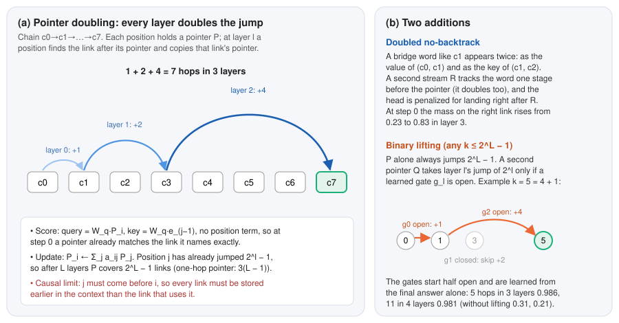
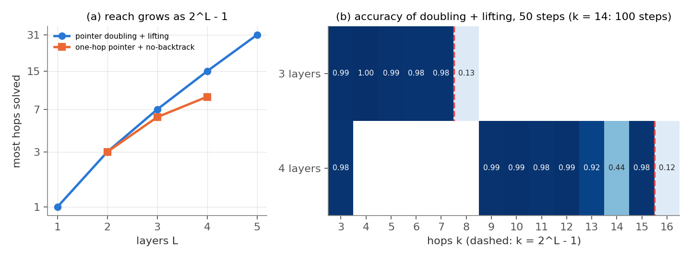
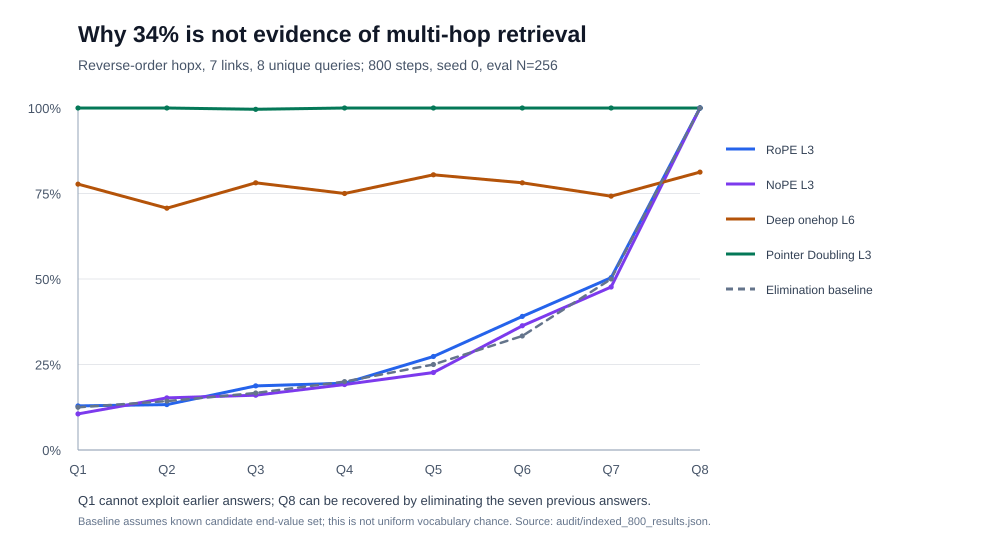
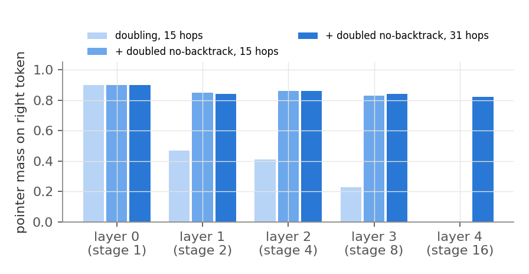

> **Research audit correction — 2026-11-17 (this branch only).** The original author's tables and figures used all-query teacher-forced recall but labeled a flat 1/N chance line; this is invalid for later questions because each previous answer is visible. The analytic candidate-elimination reference for N=8 is H8/8=33.973%, while the FIRST-query reference is 1/8=12.5%. This branch preserves legacy values for provenance but supersedes their scientific interpretation. See [reviewer six-point response](audit/REVIEWER_SIX_POINTS_2026-11-17.md), [raw corrected metrics](audit/first5_3000_adamw_results.json), and [corrected indexed figure](figs/query_index_corrected.svg). **Do not cite legacy plots as chance-adjusted multi-hop evidence.**

# Following Long Chains of Facts in the Prompt: An Attention Head That Doubles Its Jump Every Layer Follows 7 Links With 3 Layers and 31 With 5

Vuk Rosić · [AI Research School](https://www.skool.com/become-ai-researcher-2669) · November 2026 · draft for ICML 2027

## Abstract

Store a chain of facts in a transformer's prompt (a→b, b→c, c→d), ask where a leads after k links, and score only the answer. In our short runs, tuned attention and published head variants stay near chance on long chains, and earlier pointer heads add a few links per layer. We build a head that doubles its jump every layer. Each position keeps a pointer; a layer finds the link that follows the pointer and copies that link's own pointer, so L layers cover 2L − 1 links. A penalty for stepping back, doubled the same way, keeps the match sharp at initialization, and a gated second pointer takes a layer's jump only when needed, for shorter chains. It learns them from the first training steps, across widths, contexts and filler tokens. Freezing the pointer or removing either addition removes the gain. It needs each link stored before the link that uses it; a mirrored head that doubles backward from the chain's end handles normal order with half the reach. It fails on longer chains and slightly raises text loss.

**In simple words.** Imagine a treasure hunt where each note tells you where the next note is, and you have three moves to reach the end of a seven-note trail. Walking note by note, you get three notes in. Now suppose every note also says where the note after next is, and after that, where the note four ahead is. Then three moves cover 1 + 2 + 4 = 7 notes. Our attention head builds those "two ahead" and "four ahead" notes on its own, one layer at a time, with no extra training signal. A second pointer can skip any of the jumps, so it can stop at note 5 or note 6 as well.

*Figure 1. (a) Pointer doubling: at layer l each position finds the link after its pointer and copies that link's pointer, which already jumped 2l − 1 links, so the jump doubles. Every link must be stored before the link that uses it. (b) Two additions: a doubled no-backtrack stream keeps the match sharp at step 0, and a gated second pointer adds or skips each layer's jump, so any count up to 2L − 1 is reachable.*

## 1. Introduction

**The finding.** An attention head that copies the pointer of the link it found, instead of the link's token, doubles its reach in every layer. With two small additions, L layers then follow in-context chains of any length up to 2L − 1 links, from the first training steps, when only the final answer is scored.

A *k-hop lookup* chains k lookups inside the context. The context lists pairs: one block maps cat→dog, another maps dog→sun, another sun→red. The question "cat?" has the 3-hop answer "red". The model is never told "dog" or "sun". Code has such chains: a variable assigned from another variable.

In our earlier paper (identity and pointer heads), one head per layer matches a token against the position right after its earlier copy, with no position term, so the match is exact at step 0. That match is the key and value form of Memory Mosaics (Zhang et al. 2025, 2405.06394), placed inside a standard transformer. A *pointer* carried from layer to layer becomes the embedding of the token found, so each layer follows the next link. That fixed credit assignment, but the pointer moves at a fixed speed. On the chains used here it reaches 3, 6 and 9 links with 2, 3 and 4 layers. The reach grows in a straight line with depth.

Theory says depth can be much cheaper. Sanford, Hsu and Telgarsky (2024) prove that k-hop induction can be done in about log2 k layers with a doubling construction, and that this depth is also needed. Merrill and Sabharwal (2025) show log-depth transformers solve graph connectivity by path doubling. These are hand-built weights; our tuned baselines do not find them in 50-100 steps without middle answers (Section 5), although trained transformers do learn chains and graph search in other setups (Section 9).

Our head builds the doubling in; the exact match it starts from is prior work, and the doubling, the doubled no-backtrack term and the gated pointer are new. Each position i holds a pointer P(i). At layer l the head scores each position j by how well P(i) matches the token before j, finds the link that follows i's pointer, and copies *that link's pointer* P(j), not its token. Position j has already jumped 2l − 1 links by then, so i's jump doubles. After L layers the pointer has covered 1 + 2 + … + 2L−1 = 2L − 1 links.

Plain doubling has two problems. The match blurs with depth at step 0, because a bridge token is both a value and a key; a no-backtrack term that doubles with the pointer fixes this. And doubling always lands on 2L − 1, so a 5-link chain in 3 layers overshoots; a second pointer takes layer l's jump only when a learned gate is open, as in binary lifting (5 = 4 + 1).

The finding rests on four claims:

1. **Reach.** The full head (doubling, doubled no-backtrack and lifting) follows chains of up to 2L − 1 links with L layers: 7 links in 3 layers, 15 in 4 and 31 in 5, and 12 of the 15 shorter counts we tried. Every chain longer than 2L − 1 fails (Section 4).
2. **Recall against competitors.** In four settings it scores 0.98-0.99 while tuned attention, KV shifting, Primer, n-gram heads and the one-hop pointer stay at 0.06-0.31, each with its own learning-rate sweep. The lead holds from width 32 to 256, from 8 to 24 pairs and with filler tokens, and grows with context (Section 5).
3. **Mechanism.** Freezing the pointer at test time, switching off the pointer heads, removing the doubled no-backtrack term or removing the gated pointer each drops accuracy to near chance, while switching off as many normal heads leaves it at 0.985 (Section 6).
4. **Limits as a rule.** Doubling along the chain needs each link stored earlier than the link that uses it; in forward order it fails even 3 links, and a mirrored head that doubles backward from the chain's end recovers forward chains of 2L−1 links. Chains longer than 2L − 1 fail. On text the doubling head ties the best identity head and the two-pointer version costs loss (Section 7).

## 2. Method

**Base head (prior work).** We start from the pointer head of the earlier paper, whose exact match is the Memory Mosaics key (Zhang et al. 2025, 2405.06394): the key uses the same function as the query, with no position term, and the value comes from the next token. We claim only the three parts that follow: the doubling update, the doubled no-backtrack term and the gated second pointer. Keep a pointer P next to the hidden state; P0(i) is the embedding e(i) of the token at i. Head 0 of layer l scores

  s(i, j) = t · norm(Wq Pl(i)) · norm(Wq e(j − 1)),

with the layer's own query weights on both sides, a learned temperature t per layer (started at 3 · √dk), and no position term. Causal masking keeps j ≤ i. If the token at j − 1 equals the token named by Pl(i), the two vectors are identical and the score is the largest possible. So the head finds "the position right after the token my pointer names" at step 0. With a = softmaxj(s), the one-hop pointer updates Pl+1(i) = Σj a(i, j) e(j): the pointer becomes the embedding of the token found.

**Doubling.** We change one symbol:

  Pl+1(i) = Σj a(i, j) Pl(j).

Position j sits right after the token Pl(i) names, and its own pointer Pl(j) has already moved 2l − 1 links along the chain from j's token. Copying it moves i's pointer by 2l links in total. The key stays the token before j, so the match at layer l is still exact at step 0. Head 0's value is the pointer itself (Section 6 shows a normal value fails). The other heads stay normal.

**Doubled no-backtrack.** A bridge token like "dog" appears twice: as the value of (cat, dog) and as the key of (dog, sun). In the one-hop pointer, a no-backtrack term lowers positions whose token two back is the token the pointer just left. Under doubling, "the token just left" is no longer Pl−1. We keep a stream R that names the token one stage before the pointer and doubles along with it:

  R1 = P0, Rl+1(i) = Σj a(i, j) Rl(j),

and subtract 3 · cos(Rl(i), e(j − 2)) from s(i, j). At step 0 on a 15-link chain in 4 layers, the attention mass on the right link is 0.90, 0.47, 0.41, 0.23 by layer without this term and 0.90, 0.85, 0.86, 0.83 with it (Figure 4).

**Binary lifting.** P always jumps 2L − 1 links. For any count k up to that, head 1 moves a second pointer Q:

  Ql+1(i) = gl · Σj aQ(i, j) Pl(j) + (1 − gl) · Ql(i),

where aQ is head 1's attention, scored with Ql as the query in the same way, and gl = sigmoid(γl) is one learned scalar per layer, started at 0.5. If gl is open, Q copies the 2l-link pointer of the link after Q, so it jumps 2l links; if closed, Q stays. Q has its own doubled no-backtrack stream, mixed by the same gate, and also returns Pl(j) as its value. The gates learn k from the final answer alone; k is fixed per task.

**Readout and parameters.** The rest of the model is unchanged. Heads 0 and 1 reuse the layer's Wq; the parameter count equals the base model's (145,920 body weights at 3 layers, 194,560 at 4) plus one gate scalar per layer.

## 3. Setup

**Task (corrected evaluation note).** The context has k blocks of N (key, value) pairs. Block c maps tokens from vocabulary range c to range c + 1, in its own random order. Then come N queries, one per range-0 key, each with a supervised answer. **Earlier ground-truth query answers are included in the causal context of later queries.** A candidate-set-aware, no-chain-tracing elimination strategy has per-query expected accuracy 1/(N-j+1) on query j (1-indexed); averaging all N queries gives H_N/N, **0.33973 for N=8**. Only the **first query** has candidate-set chance 1/N=0.125. The vocabulary-uniform chance 1/V is a different prior and should not be substituted for either. The blocks are stored in *reverse* order: the block that maps range k − 1 to range k comes first, and the block a query starts from comes last. So every link is stored before the link that uses it. Section 7 tests forward and random order. Variants add 2 filler tokens per pair, or replace 30% of the fillers with chain tokens in wrong places.

**Model.** A small transformer with 4 heads per layer, QK-norm, Muon on weight matrices and Adam on embeddings and scalars, width 64 unless noted, 1-5 layers. Recall runs use batch 16 and 50-100 steps, evaluated every 25 steps, stopping at 0.99. At 5 layers we use 4 pairs (31 links × 4 pairs keeps the context under 300 tokens).

**Arms.**

| Arm | What it adds | Source |
|---|---|---|
| Tuned attention | ALiBi + attention sink | |
| KV shifting | keys and values mixed with the previous position's | Xu et al. 2024, 2411.19574 |
| Primer | depthwise convolution over queries, keys and values | So et al. 2021, 2109.08668 |
| n-gram heads | heads that attend after exact token matches | Akyürek et al. 2024, 2401.12973 |
| One-hop pointer + no-backtrack | the pointer head of the earlier paper | Rosić 2026 |
| Doubling (DNB) | doubling + doubled no-backtrack, no lifting | this paper |
| Doubling + lifting (full head) | doubling + doubled no-backtrack + gated second pointer | this paper |

**Tuning.** Tuned attention, KV shifting, Primer and n-gram heads were run at learning rates 0.01, 0.04 and 0.08 in the 7/3, 11/4 and 15/4 cells (k links / L layers), the one-hop pointer at 0.01-0.04, and the full head at 0.01, 0.02 and 0.04. Each arm's best rate is reported. The full head scores 0.974-0.987 at every rate.

**The grid.** The study ran 218 runs in 34 blocks: links 1-32, layers 1-5, widths 32-256, 4-24 pairs, contexts up to 384 tokens, filler, repeated tokens, chain order, learning rate, ablations, an initialization probe and one text cell.

## 4. Claim 1: L layers reach 2L − 1 links

*Figure 2. (a) The longest chain solved (accuracy ≥ 0.9) against depth. The full head reaches 1, 3, 7, 15 and 31 links with 1-5 layers; the one-hop pointer reaches 3, 6 and 9 with 2-4 layers. Log scale. (b) Accuracy of the full head by chain length at 3 and 4 layers, 8 pairs, 50 steps.*

Table 1 gives every cell. At 2L − 1 links the head solves all five depths: 1/1 (1.000), 3/2 (0.995, doubling without lifting), 7/3 (0.979), 15/4 (0.977) and 31/5 (0.964, 4 pairs). Each crossed 0.90 by step 25, except 31/5 by step 50.

**Table 1 (legacy, superseded evaluation).** Author's original **all-query teacher-forced** averages (8 pairs, 50 steps); the correct 8-query no-chain candidate-elimination reference is **0.33973**, not 0.125. The **first-query** candidate-set reference is 0.125. These original cells are retained for provenance, not used for new first-query claims. Bold: chains longer than 2L − 1.

| Layers | Links: accuracy |
|---|---|
| 1 | 1: 1.000 · **2: 0.038** |
| 2 | 2: 1.000 · 3: 0.995 (DNB) |
| 3 | 3: 0.989 · 4: 0.999 · 5: 0.986 · 6: 0.978 · 7: 0.979 · **8: 0.131** |
| 4 | 3: 0.979 · 9: 0.987 · 10: 0.991 · 11: 0.981 · 12: 0.992 · 13: 0.923 · 14: 0.343 (0.438 at 100 steps) · 15: 0.977 · **16: 0.120** |
| 5 (4 pairs, chance 0.25) | 18: 0.288 · 20: 0.237 · 24: 0.955 · 31: 0.964 · **32: 0.229** |

Shorter chains need the gated pointer. Of the 15 counts below 2L − 1 we tried, 12 pass at 0.92-1.00. Three fail: 14 links in 4 layers (0.34, 0.44 after 100 steps), and 18 and 20 links in 5 layers (0.29, 0.24). Their binary codes show no pattern the passing counts lack (12 = 1100 passes, 14 = 1110 fails); we report them as open failures.

Chains longer than 2L − 1 fail in all four cells (2/1, 8/3, 16/4, 32/5): the pointer cannot move further than the sum of its jumps.

**Why the one-hop pointer gets 3(L − 1).** On reverse-ordered chains the one-hop pointer solves 3/2 (1.000), 5/3 (0.991), 6/3 (0.999) and 9/4 (0.998), and fails 7/3 (0.208) and 10/4 (0.166). Its reach grows by a fixed step per layer; the doubling head's reach doubles (Figure 2a).

A self-loop that would let pure doubling stop early failed (11/4 at 0.16-0.22); the gated pointer replaced it.

## 5. Claim 2: it wins in every setting, and the lead grows with context

**Original Figure 3 retired from evidence:** [legacy chart with incorrect horizontal chance lines](figs/recall.png). Its dashed 0.125/0.0625 lines correspond only to an unobserved first query assuming N known candidates, **not** the eight/sixteen teacher-forced query average in the chart. It must not be used to quantify a multi-hop win.

*Corrected figure. Actual accuracy by query position on the independently replicated 7-hop/8-pair/800-step cell (single seed), versus the query-index-specific elimination reference 1/(N−j+1). See [indexed_800_results.json](audit/indexed_800_results.json); the first query is our primary outcome.*

**Table 2 (legacy, superseded evaluation).** Author's all-query teacher-forced accuracy, best learning rate per arm. The relevant candidate-elimination reference is H_N/N; do not compare these values to a horizontal 1/N chance line.

| Setting | Tuned attention | KV shifting | Primer | n-gram heads | One-hop pointer | Doubling, no lifting | Full head |
|---|---|---|---|---|---|---|---|
| 7 links, 3 layers | 0.269 | 0.269 | 0.263 | 0.157 | 0.208 | 0.981 | 0.987 |
| 11 links, 4 layers | 0.293 | 0.289 | 0.275 | 0.170 | 0.194 | 0.207 | 0.981 |
| 15 links, 4 layers | 0.295 | 0.273 | 0.311 | 0.219 | 0.288 | 0.993 | 0.984 |
| 7 links, 3 layers, 16 pairs (256 tokens) | 0.125 | 0.072 | 0.063 | 0.055 | 0.081 | | 0.991 |

In the author's **legacy all-query metric** the full head scores highest; however, its reported difference to competitors includes the teacher-forced answer-elimination confound and short training budgets. Updated first-query comparisons with long-trained NoPE/RoPE and deep single-hop pointers are required for a valid effect size; see the audit linked above. Doubling without lifting matches the full head when k = 2L − 1 and fails at 11 links, where it overshoots.

**Scaling knobs.** Table 3 moves one knob at a time from the 7/3 cell.

**Table 3.** Full head against the best other arm in the same cell.

| Cell | Full head | Best other arm |
|---|---|---|
| width 32, temperature 10 | 0.925 | 0.165 (tuned attention) |
| width 128 | 0.979 | 0.277 (tuned attention) |
| width 128, 15 links, 4 layers | 0.972 | 0.202 (one-hop pointer) |
| width 256 | 0.970 | 0.257 (tuned attention) |
| 16 pairs, 256 tokens | 0.991 | 0.125 (tuned attention) |
| 24 pairs, 384 tokens | 0.998 | 0.066 (tuned attention) |
| 2 filler tokens per pair, 240 tokens | 0.992 | 0.166 (KV shifting) |

In the **legacy metric**, the raw gap increases with the number of pairs. Because its correct candidate-elimination reference changes as H_N/N and the training budget was short, these values do **not** establish a corresponding increase in true multi-hop advantage. Along depth the lead grows too: at 4 layers the next-best method, the one-hop pointer, reaches 9 links; the full head reaches 15. It holds at 0.97-0.99 from width 64 to 256. Width 32 needs a sharper starting temperature (Rule 5). Filler tokens do not matter (0.992); the pointer matches tokens, not offsets.

## 6. Claim 3: the doubled pointer is the cause

*Figure 4. Attention mass of the pointer head on the right link, per layer, at step 0 (15 links in 4 layers, and 31 links in 5 layers). Without the doubled no-backtrack term the mass halves with depth; with it the mass stays at 0.82-0.90.*

We ran five controls on the trained 7/3 model and on matched cells (Table 4).

**Table 4.** Controls.

| Change | Cell | Accuracy |
|---|---|---|
| none (full head) | 7/3 | 0.984 |
| pointer frozen at test time | 7/3 | 0.038 |
| pointer heads switched off at test time | 7/3 | 0.029 |
| the same number of normal heads switched off | 7/3 | 0.985 |
| pointer heads switched off in the last layer only | 7/3 | 0.024 |
| doubled no-backtrack removed | 11/4 · 15/4 | 0.139 · 0.196 (full head 0.981 · 0.977) |
| gated second pointer removed | 5/3 · 10/4 · 11/4 · 12/4 | 0.309 · 0.146 · 0.207 · 0.130 |
| pointer used only for the update, value left normal | 15/4 | 0.257 (with value 0.941) |
| sink + ALiBi kept on the normal heads | 15/4 | 0.298 (without 0.941) |

**Pointer and heads.** A frozen pointer drops accuracy from 0.984 to 0.038, below chance: the model has no other route to the answer. Switching off the two pointer heads gives 0.029 and two normal heads 0.985; the last layer's pointer heads alone carry the answer (0.024 without them).

**No-backtrack.** Removing the doubled no-backtrack term fails 11 and 15 links in 4 layers (0.14, 0.20). Figure 4 shows why: without it, the step-0 mass on the right link falls to 0.23 by layer 3, so deep layers start from a blur; with it, the mass stays at 0.82-0.86.

**Lifting.** Without the gated pointer, the counts that are not 2L − 1 fail (0.13-0.31), and the counts that are 2L − 1 still pass (0.98-0.99).

**Value and position terms.** The pointer must also be returned as head 0's value. When it drives only the update, 15 links fail (0.257). Keeping an attention sink and ALiBi on the normal heads also fails 15 links (0.298), for reasons we did not find.

## 7. Claim 4: where it fails, as a rule

**Rule 1: forward doubling needs every link stored before the link that uses it.** Doubling copies P(j) from a position j earlier than i. That pointer has jumped 2l − 1 links only if the links it needed lie even earlier. With chains in forward order (the block a query starts from comes first), the full head fails 3 links in 3 layers (0.033), 4 links (0.042) and 7 links (0.082). With a random block order per row, 7/3 gives 0.056. The one-hop pointer solves 3/3 forward (0.991), since it only reads the next token each layer; it fails 7/3 forward (0.110). This is a causal limit: no causal head can read a pointer not yet computed.

**Normal-order chains: double backward.** A mirrored head, *predecessor doubling*, handles forward order. Each pair's position holds a pointer that starts as its own key ("b" for b→c). Each layer, head 0 finds the earlier pair whose value equals the pointer (a→b) and copies that pair's pointer, so the pointer names the token 2l links back along the chain; again the doubling comes from copying an already-jumped pointer. In the last layer a readout head lets the query find the pair whose far ancestor is the query and returns that pair's value. Everything it reads lies earlier in the context. One layer reads out, so L layers reach 2L−1 links (Table 5).

**Table 5.** Forward-order chains, 8 pairs, 100 steps (16 links: 4 pairs, chance 0.25, 200 steps).

| Links / layers | Tuned attention | One-hop pointer | Forward doubling | Predecessor doubling |
|---|---|---|---|---|
| 2 / 2 | | | | 0.987 |
| 4 / 3 | 0.126 | 0.119 | 0.042 | 0.976 |
| 8 / 4 | 0.223 (KV shifting 0.194) | 0.221 | | 0.915 |
| 16 / 5 | 0.465 (100 steps) | | | 0.818 |

Copying the predecessor's token instead of its pointer (no doubling) gives 0.133 at 8/4. Plain predecessor doubling reaches only the count 2L−1: 5 links in 3 layers fail (0.116); a gated version that picks a doubling or a single step per layer solves 3/3 (0.988). Accuracy falls with depth (0.99 to 0.82); lifting, no-backtrack and random order are untested for this direction.

**Rules 2 and 3: length.** Chains longer than 2L − 1 fail (4 of 4 cells), and 3 of 15 shorter counts failed (14/4, 18/5, 20/5; Section 4).

**Rule 4: repeated chain tokens hurt.** When 30% of the filler tokens are replaced by chain tokens in wrong places, the full head drops to 0.763 (best other arm 0.051). An exact match on a repeated token is ambiguous, as for the one-hop pointer (0.79 there).

**Rule 5: width 32 needs a sharper temperature.** 0.118 at the default, 0.925 at 10.

**Rule 6: on text, doubling ties and lifting costs.** On web text (FineWeb, 2,000-token vocabulary, width 64, 4 layers, context 256, 150 steps), tuned attention reaches 3.8002 validation loss and a pair-match identity head 3.7782. One doubling head added to the pair-match head gives 3.7835, a tie; the full two-pointer head gives 3.8098, 0.010 worse than tuned attention. For text alone use the pair-match head. This is one unscaled text cell.

## 8. Cost

Parameters equal the base model's plus one scalar per layer. Each layer adds four weighted sums over t positions (P, R, Q and Q's no-backtrack stream) and two t × t cosine maps. Training took 7-27 s for 50 steps at 3-4 layers against 4-7 s for tuned attention, on a shared laptop where times vary by about 2×; we did not build a fused kernel.

## 9. Related work

**Log-depth multi-hop theory.** Sanford, Hsu and Telgarsky (2024, 2402.09268) show that k-hop induction needs, and can be built with, about log k layers, using hand-built doubling weights. Merrill and Sabharwal (2025, 2503.03961) show log-depth transformers solve graph connectivity by path doubling and study depth against learnability. Liu, Yu, Sanford, Andoni and Hsu (2025, 2509.09001) give an attention variant reaching k-hop at near-optimal depth, as theory. Our contribution is not the bound but a trainable head with the doubling built in, which training on the final answer uses from step 25, the two additions it needs, and the order rule.

**Learned shortcuts.** Liu et al. (2023, 2210.10749) show that shallow transformers learn log-depth shortcuts for automata, with supervision at every step and no built-in mechanism. Guo et al. (2025, 2502.13913) analyze two-hop reasoning with distractors.

**Pointer jumping.** Doubling pointers is the classic parallel list-ranking algorithm (Wyllie, 1979), and binary lifting is the standard way to jump any k with log k tables. Pointer Graph Networks (Veličković et al. 2020, 2006.06380) learn pointers in a graph network with supervision on the pointers, without doubling. The Pointer architecture (2508.02631) chains pointers across layers one link at a time.

**Learning chains by training.** Saparov et al. (2024, 2412.04703) find that transformers trained on graph search expand the set of reachable nodes in each layer, so the reach grows exponentially with depth, and that this gets harder to learn as graphs grow. Mușat (2024, 2411.12118) finds that plain transformers learn multi-hop retrieval through an implicit curriculum, and Wu, Geiger and Millière (2025, 2505.20896) train a transformer to follow chains of variable assignments. Our competitors' failure holds only for our budget: 50-100 steps, no middle answers, no curriculum. What we add is a head that makes the doubling available at step 0.

**Exact match at init.** The match comes from Memory Mosaics (2405.06394; at about 10B parameters in 2507.03285), whose key uses the same function as the query, with no position encoding, and whose value comes from the next token. Induction heads also form with frozen random query and key weights (2506.01115), so one-hop copying does not need this match; Section 6 shows that the doubled chain does, in our budget.

**Heads for in-context recall.** n-gram heads (Akyürek et al. 2024, 2401.12973), KV shifting (2411.19574) and Primer (2109.08668) make one-hop copying easier; none carries a pointer, and none leaves the 0.06-0.31 band here. End-to-End Memory Networks (Sukhbaatar et al. 2015, 1503.08895) feed the retrieved memory into the next hop, one hop per layer. Our earlier pointer heads give one exact hop per layer.

## 10. Limits and reviewer check

All models are small: width 32-256, 1-5 layers, 50-100 training steps on recall, one text cell of 150 steps. Competitors trained 50-100 steps here; in the earlier paper they stayed at guessing on 2-hop chains after 1,200 steps. Each cell is a single run; 218 runs cover the grid.

We reviewed the paper as an ICML reviewer would. Remaining gaps:

1. **Mixed chain lengths.** The gates encode one k per task. Compute the gates from the query token and train on mixed k in one model.
2. **Both orders at full reach.** Add lifting and the doubled no-backtrack term to predecessor doubling, and train both heads in one model on mixed and random chain orders.
3. **The three failing counts** (14/4, 18/5, 20/5). Find why the gates miss them.
4. **Longer chains and real scale.** Run 6-7 layers (63 and 127 links) and a 125M model with one doubling head per layer, and test in-context variable tracking (RULER) and code where definitions precede their use.
5. **Long competitor runs** of 1,000+ steps on the 7/3 and 15/4 cells.
6. **Speed.** A fused kernel and a wall-clock comparison.

## Code

| File | What it does |
|---|---|
| `pdg.py` | recall task (links, pairs, order, filler, repeats) and all heads; `--ptr 11 --pnb 3` is the full head, `--ptr 4 --pnb 3` doubling without lifting, `--ptr 6` / `--ptr 8` predecessor doubling (plain / gated) |
| `pdlm.py` | text model on FineWeb with the same heads |
| `grid.py` | runs a block of cells one at a time and prints one line per run; arm macros (F, KVS, PRI, NG, PNB, DNB, BLN) |
| `reproduce.sh` | the headline in 67 seconds: 7/3 tuned attention 0.17 vs full head 0.97; 15/4 one-hop pointer 0.17 vs full head 0.99 |
| `make_figs.py` | Figures 2-4 from the logged numbers |
| `results.jsonl` | every run (218 lines) |
| `RESULTS.md` | the study log: predictions, which held, all tables |

## Appendix: numbers behind the figures

**Figure 2a** (longest chain at ≥ 0.9): full head 1, 3, 7, 15, 31 at 1-5 layers; one-hop pointer 3, 6, 9 at 2-4 layers (fails 7/3 at 0.208 and 10/4 at 0.166).

**Figure 4** (mass on the right link at step 0, layers 0-3 or 0-4): 15/4 plain doubling 0.90, 0.47, 0.41, 0.23; 15/4 with doubled no-backtrack 0.90, 0.85, 0.86, 0.83; 31/5 with doubled no-backtrack 0.90, 0.84, 0.86, 0.84, 0.82.
